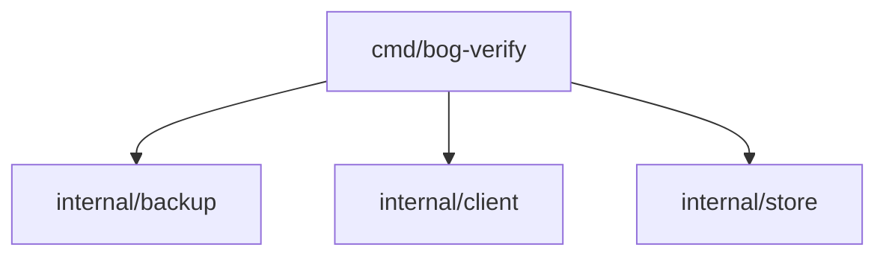

# ADR 0012 — Command roots and staged package promotion

**Status** — Accepted for Cycle 12. The command root checks apply to the
legacy server graph and to the #53 composition.

## Context

`cmd/bog` composes one Linux process, one listener, one WAL owner, and one
pinned data directory. In the #53 and #60 composition, it supplies HTTP's
page source and the readiness directory handle. It sequences writable
recovery and live generation replacement through the owner.
`cmd/bog-verify` runs separately and compares
a read-only backup image with a server restored to the same recovery point.
Both commands can use the same read-side storage code. The release verifier
uses an independent query oracle to derive expected rows from its fixture.
[Runtime storage composition](0007-runtime-storage-composition.md),
[Read-only operator verification](0011-operator-verification-boundary.md),
[Release verifier composition](0008-release-verifier-composition.md)

## Decision

Keep the Linux production roots registered. `cmd/bog` has the server command
role. Operator commands use the verifier command role in the fitness registry.
Their registered root-module production graphs must satisfy these rules.

| Root | Excluded destinations, direct or transitive | Intended dependencies |
| --- | --- | --- |
| `cmd/bog` | `internal/client`, `verify/query-model` | Server and storage packages reached through the production composition |
| `cmd/bog-verify` | `internal/wal`, `internal/httpapi`, `internal/readiness` | Read-only backup APIs, production HTTP client, and shared row types |
| `cmd/bog-export` | `cmd/bog`, `internal/httpapi`, `internal/readiness`, `internal/wal`, `internal/backup`, `internal/checkpoint`, `internal/history`, `internal/idempotency`, and packages at or under `verify` and `bench` | Exactly one direct root-module import, `internal/client`, which may use shared row types |

The server supplies query results without relying on either the caller's
HTTP client or the independent model used to verify it. The operator
command obtains the same client framing and cursor handling as any other
caller and has no dependency on the packages that own the running server.
The roots may share backup, checkpoint, history, and store where the
composition uses them. The HTTP paging seam and storage authority rules
continue to govern which packages can reach those libraries and the WAL
owner. [HTTP paging boundary](../../internal/archtest/cutover_boundaries_test.go),
[Storage authority boundary](../../internal/archtest/storage_authority_test.go)

`cmd/bog-export` reads the server's query view through HTTP. Release evidence
commands establish production ownership of verifier support packages.
[Operator export boundary and #53 registry handoff](0032-operator-export-boundary.md)

The exact-import and cycle suite checks the registry against the Linux
production inventory on amd64 and arm64. The companion checks traverse
registered imports from the command roots and forbid the destinations by
package path. Registering a helper or giving a forbidden destination a
runtime role cannot authorize the path. Fixtures cover shared read-side
dependencies under staged and wired roles as well as registered bypasses.
Test imports remain outside the production graph. Import checks constrain
package dependencies. The operator command's tests cover how it uses
the APIs of those packages.
[Linux architecture registry](../../internal/archtest/architecture_test.go),
[Server boundary check](../../internal/archtest/command_roots_test.go),
[Operator boundary check](../../internal/archtest/operator_boundary_test.go)

## Promotion and ownership

A staged library becomes wired when it is reachable from `cmd/bog` in the
measured Linux production inventory, directly or through a dependency.
An operator or release verifier can use a staged library before server
wiring. Promote checkpoint, history, and backup individually as the composed
graph reaches them. Keep idempotency staged until the WAL durably commits
and recovers retry records atomically with their batches and the ingest
activation criteria pass. [Keyed ingest activation criteria](../architecture/SYSTEM.md#package-registry)

Core engineering owns the architecture registry, command boundary tests,
and system architecture record. `bog-storage` owns #53 server composition and
coordinates the registry and diagram update with core engineering at the
wiring handoff. Recheck the applicable write leases at assignment and
handoff. #60 follows the #53 command lease. Measure both Linux targets with
the existing suite's build settings on the composed revision. Update the
observed revision, direct edges, and roles together in the wiring change,
including removal of retired edges. Run the architecture suite and Linux
cross-build on the baseline and composed tree before the #53 release gate.
[Fitness and registry ownership](../architecture/SYSTEM.md#fitness-and-registry-ownership)

Shared read-side code lets both commands reuse the image format and row
types. The separate verification process requires operators to supply an
immutable image and an endpoint held at the matching recovery point.
Explicit roles and measured edges require registry updates alongside wiring
changes and make earlier or transitive activation visible during review.

## SYSTEM.md handoff for #53

Follow ADR 0032 for the exporter registration and lease handoff.
[Exporter integration and qualification](0032-operator-export-boundary.md#integration-and-qualification)

Add the operator root outside the server subgraph using the following
operator edges, observed on both Linux targets at `e345ff8`. Re-measure
them on the composed revision and place retained library nodes according
to their measured server reachability. Arrows show direct production imports.

Remove the pending #67 row and use these registry entries. For each retained
library, use `Wired` when the composed server reaches it and `Staged` while
it awaits server wiring.

| Package or entry point | Role | Responsibility |
| --- | --- | --- |
| `cmd/bog` | Server command | Writable recovery, listener, and lifecycle |
| `cmd/bog-verify` | Operator command (verifier role in the fitness registry) | Read-only backup verification and complete query parity against a separately restored server |
| `internal/client` | Standalone | Production HTTP client used by the operator and release verification commands |
| `verify/query-model` | Verifier support | Independent append-log oracle for expected query results |

Use this wording alongside the package registry and diagram.

> Wired libraries are reachable from `cmd/bog` in the measured Linux
> production graph. `cmd/bog-verify` is a separate registered operator root.
> It may share read-side storage libraries with the server and must have no
> production import path to the WAL owner, server HTTP, or readiness.
> `cmd/bog` must have no production import path to the Go HTTP client or
> independent query oracle. Operator or release verifier use alone leaves a
> staged library's server role unchanged.
