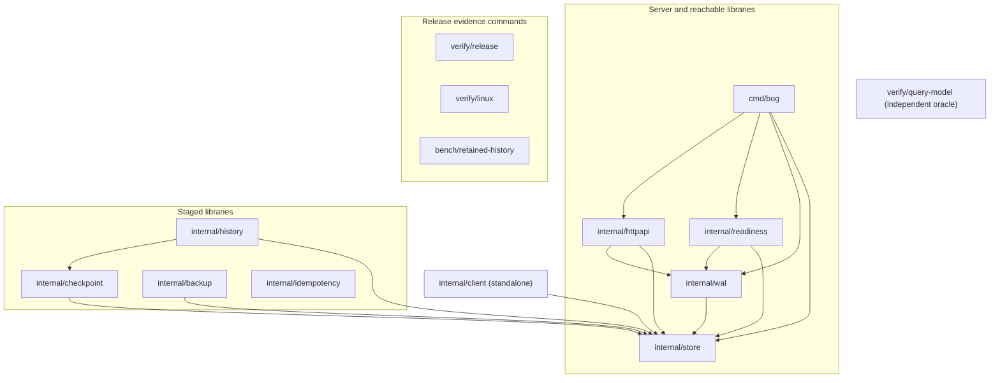

# Bog system architecture

One Linux process, one HTTP listener, one WAL owner, and one pinned local data
directory form Bog's deployment and consistency unit. `cmd/bog` acquires the
exclusive directory lock, recovers the committed state, and then opens the
listener. The owner holds the lock through HTTP drain. If drain fails, the
process exits with the WAL still open so handlers cannot race another owner.

The WAL owner controls append order and when a complete batch becomes durable
and query-visible. The service requires a trusted, service-owned local
filesystem with advisory locking, atomic rename, file and directory sync, and
powersafe overwrite. Keep each data directory under a single writer. The
listener exposes ingest and query without authentication. Deploy it on a
trusted network or behind an authenticated access layer.

## Observed Linux production imports

These are the direct imports between root-module production packages at
`d67892082f0ea3e9a951e55076d5eb80127bf031`, listed for Linux amd64 with
cgo disabled. Arrows point from importer to dependency. Test-only packages
are listed in the registry below. Nodes with no outgoing arrows have zero
direct root-module production imports.

- **Ingest** validates complete NDJSON batches before appending. The WAL syncs
  frames, syncs and renames the temporary commit marker over `bog.commit`,
  syncs the directory, and publishes whole batches before HTTP returns 204.
  A confirmed rollback returns 503 and publishes no rows. An uncertain commit
  or rollback poisons the writer and terminates the process on the served
  path. Recovery validates the committed prefix and discards uncommitted bytes.
- **Queries** match a case-sensitive literal within a half-open time range.
  UTC timestamp and append ordinal determine order, including ties,
  duplicates, and backfill. The base serves a replayed in-memory store.
  Admission, scan work, and response bytes have independent limits.
- **Health** reports listener liveness at `GET /healthz` after recovery.
  `GET /ready` combines disk headroom sampled from the configured directory
  path and the terminal WAL group outcome. A rollback reports `wal_rollback`
  until a later durable outcome. An uncertain outcome reports
  `recovery_required` while the process serves. #60 plans to bind disk samples
  to the active WAL filesystem through the descriptor handoff in
  [ADR 0005](../adr/0005-pinned-writable-recovery-authority.md#readiness-descriptor-handoff-60).
- **Recovery** at this revision opens the legacy WAL layout. Under the
  directory lock, the command rejects a directory containing `bog.backup`
  or `bog.wal.tail`. The offline backup reader validates restored images.
  [ADR 0003](../adr/0003-wal-capture-and-restored-image-startup.md) records
  the startup guard and capture design.

## Pending imports and role changes

| Wiring | Expected graph or role change |
| --- | --- |
| #53 with #59 | `cmd/bog` wires the retained adapter to the WAL owner and retained libraries. Promote checkpoint, history, and backup from staged to wired when the Linux server reaches them. Record the command's actual direct imports and any edges retired by the wiring. |
| Release client integration | Expect `verify/release` to import `internal/client` for paging. Register a separate `verify/release` import of `verify/query-model` if the semantic comparison uses it from production verifier code. Restored-parity test imports are outside the production graph. The client remains standalone and the oracle remains verifier support. |
| Crash-safe backup staging | Storage owns the publication lifecycle for staging and cleanup. Apply any graph changes with the production imports that introduce them. Runtime reachability determines backup's role. |

## Retained-history handoff

At cutover, the retained adapter lives in `cmd/bog` and implements HTTP's
consumer-owned `PageSource`. HTTP owns admission, cursor authentication and
lifetime, and NDJSON framing. The WAL owner selects and activates writable
recovery state for ordinary WAL directories, retained generations, and
verified restores. The adapter reads a coordinated capture from the owner and
history catalog. Checkpoint validates and durably publishes immutable
generations. History owns generation pins, segment scans, and reclamation.
Store owns decoded tail rows and their order. Backup consumes a pinned
storage view. Checkpoint, history, and backup receive readers, bounds, and
pins through composition and must have no production import path to the WAL
owner. The packages providing storage, including the staged retry library,
stay independent of HTTP, readiness, and the Go HTTP client.

The coordinated capture binds the validated generation and exact durable,
query-visible tail under the same owner. A cursor reads the same view across
generation replacement. A fresh walk sees later committed appends. Before
issuing its first cursor, HTTP certifies that the pinned walk can reach
exhaustion at the same per-request work budget and response byte cap,
including when a continuation lowers its row limit. The cursor uses the
earlier of HTTP's maximum lifetime and any source expiry. An authenticated
cursor whose capture has expired receives 410, and admitted operations
retain their references through completion.

Writable restore establishes checkpoint and tail recovery authority before
listening, and restart selects that writable authority. The opt-in loopback
capacity control drives replacement through the same owner.

ADRs 0006 and 0007 are the interface contract for core engineering and
`bog-storage`. At their review, confirm deterministic replay, captured-view
expiry, reference ownership, and commit and capture ordering. ADR 0005
governs the lifecycle handoff. The owner keeps the directory pinned through
activation, publication, and storage drain. `cmd/bog` owns the separate
readiness probe handle in #60, while readiness borrows it to sample disk
headroom and observes WAL outcomes. Capture, paging, and export references
drain before storage closes. A drain deadline leaves the owner locked until
process exit.

[ADR 0004](../adr/0004-retained-history-cutover.md)
[ADR 0005](../adr/0005-pinned-writable-recovery-authority.md)
[ADR 0006](../adr/0006-fixed-budget-query-continuations.md)
[ADR 0007](../adr/0007-runtime-storage-composition.md)

## Package registry

Wired libraries are reachable from `bog/cmd/bog` in the Linux production
graph. Staged libraries await runtime wiring. Standalone libraries have
independent consumers. Test-only packages have Linux test files and no Linux
production files. Verifier commands and support live outside the server
dependency tree.

| Package or entry point | Role | Responsibility |
| --- | --- | --- |
| `cmd/bog` | Server command | Recovery, listener, and lifecycle |
| `internal/httpapi` | Wired | HTTP validation, admission, cursors, and response framing |
| `internal/readiness` | Wired | Disk headroom and write outcome observation |
| `internal/wal` | Wired | Directory locking, commit, replay, and WAL capture |
| `internal/store` | Wired | Row decoding, publication, and ordered queries |
| `internal/checkpoint` | Staged | Legacy WAL scans, checkpoint format, and publication |
| `internal/history` | Staged | Generation validation, scans, pins, and reclamation |
| `internal/backup` | Staged | Pinned export, verification, restore, and offline reads |
| `internal/idempotency` | Intentionally staged | bog-storage owns the durable keyed-ingest backend. Activate with the HTTP ingest wiring once the production WAL commits retry records and their batches together and passes the restart retry contract. |
| `internal/client` | Standalone | Production HTTP client, complete-page framing, opaque cursor handling, and ingest outcomes |
| `internal/ingest` | Test-only | Reference decoder and fuzz tests |
| `internal/archtest` | Test-only | Linux dependency fitness suite |
| `verify/fuzz` | Test-only | Linux backup and history corruption harness with bounded inputs (#58) |
| `verify/release` | Verifier command | Admission and fixed-budget paging probes, report validation, and the restored-parity test entry point. Production-client paging integration is pending. |
| `verify/linux` | Verifier command | Linux crash recovery, ENOSPC, and readiness across path retargets (#3) |
| `bench/retained-history` | Verifier command | Legacy baseline and live capacity producer (#32) |
| `verify/query-model` | Verifier support | Independent append-log oracle for ordered membership at a captured cutoff |
| `bench/segment-layout` | Nested-module benchmark | Checkpoint layout experiment outside the root-module graph |
| `.github/workflows/linux-release.yml` | Release workflow | Pins the candidate, runs the producers, and publishes evidence |

The activation criteria for keyed retries include concurrent same-key
submissions, conflicting bodies, and retries after an ambiguous response and
process restart. [Ingest retry contract](../ingest-retries.md)

## Ranked quality attributes

| Rank | Property | Trade-off |
| --- | --- | --- |
| 1 | Durability | Wait for durable whole-batch commit before acknowledging. Sync staged data and directory publication before activating new authority. Stop on uncertain writes or committed corruption, even when availability suffers. |
| 2 | Exact queries | Preserve ordered membership through restart and, at cutover, through compaction and verified restore. Spend work before issuing a cursor to certify the full walk. Client-based qualification adds a separate comparison of ordered rows against fixture history. |
| 3 | Bounded resources | Limit captures, concurrent scans, request work, and response bytes. At cutover, bound the writable tail and retain pinned generations through cursor expiry and operation drain. Pins delay disk reclamation, and v1 format compatibility costs disk space for a readable WAL prefix. Staged backup files also consume space until publication or safe cleanup. |
| 4 | Recovery time | The base replays the committed WAL before opening the listener. Cutover trades checkpoint validation before startup for bounded tail replay. |
| 5 | Throughput | Share syncs across admitted writes and prune provably irrelevant scan work. Hashing the v1 prefix for publication and export consumes disk bandwidth. |

## Release evidence

#53 remains the retained-history release gate and qualifies the composed
#53 and #59 runtime. The workflow builds one clean Go 1.27.0 candidate on
Ubuntu 24.04 amd64 from the supplied full SHA and supplies the same binary
to four evidence sources. Every report must match the revision, binary
SHA-256, and `linux-release-v1` fixture.
[Linux release workflow](../../.github/workflows/linux-release.yml)

| Source | Report | Required evidence |
| --- | --- | --- |
| `verify/release` | `admission.json` | Saturated query slot, concurrent ingest, cursor resume, and clean work-budget rejection. Issuing budgets must complete tied-row and sparse, byte-trimmed walks, including a smaller resume limit. |
| `verify/linux` | `durability.json` | SIGKILL recovery, committed-prefix checks, and observed ENOSPC on a disposable local filesystem. Retarget the configured path in both directions and require readiness and ingest to follow the active WAL filesystem. |
| `bench/retained-history` | `capacity.json` | Confirm a newer durable generation at the exact requested cutoff, resume a held cursor across replacement during acknowledged backfill, and verify fresh ordered history including after restart. Run at both fixture sizes with bounded cgroup and process cleanup. |
| `verify/release` / `TestReleaseRestoredParity` | `parity.json` | Start the shipped binary on a verified restore, compare fresh HTTP walks, observe 204 for a new append, and recover the exact augmented history after restart. |

The `linux-release-evidence` artifact contains build identity, fixture and
runner details, reports, exit statuses, and logs. The Linux verifier race
step also runs the bounded backup and history corruption corpus in
`verify/fuzz` and records it in `verifier-race.log`. The legacy capacity
run records a baseline.
[Release verifier contract](../../verify/release/README.md)

The release client integration will use `internal/client` to qualify
complete NDJSON pages and opaque continuation handling. The verifier derives
expected membership, order, and snapshot cutoffs from the fixture and its
acknowledged appends. Low-level transport probes still supply evidence for
TCP backpressure and wire-level rejection. [ADR 0008](../adr/0008-release-verifier-composition.md)

## Fitness and registry ownership

Core engineering owns the architecture record and fitness registry, #59's
HTTP paging contract, and production-client release integration.
`bog-storage` owns #53, composes the retained adapter in `cmd/bog`, and
owns recovery and publication, including crash-safe backup staging. #60
follows the command lease handoff, and #63 follows cutover.

The #61 read lease on `internal/archtest/architecture_test.go` has cleared.
For the #53 wiring PR, core engineering and `bog-storage` coordinate the
graph and registry update under the wiring PR's write leases. Review both
sides of the current merge base, then measure the Linux production graph
with #53 and #59 composed. Update the measured revision, diagram, direct
edges, promotions, and retired entries together with their production
wiring. Apply the same rule to the production-client edge in the PR that
adds it.
[Fitness registry](../../internal/archtest/architecture_test.go)

The Architecture workflow runs `go test -count=1 ./internal/archtest`.
The suite lists packages with `GOOS=linux GOARCH=amd64 GOAMD64=v1
CGO_ENABLED=0` and `GOENV=off GOFLAGS= GO111MODULE=on GOWORK=off`. It checks
production imports within the root module and follows all listed dependencies
for server reachability. Host-only files, test imports, and nested modules
are outside the production import registry. Package loading errors, cycles,
unregistered packages, incorrect roles, forbidden imports, and stale
registered imports fail the suite. The registry requires `verify/fuzz` to
have Linux test files only. A storage dependency on HTTP, readiness, or the
Go HTTP client fails even when it is transitive or all direct edges are
registered. The companion paging check rejects any root-module production
path from HTTP to checkpoint, history, or backup, including a fully
registered path through an intermediate package. Its fixtures exercise
both command-owned adapter wiring and HTTP bypasses.
[Paging boundary check](../../internal/archtest/cutover_boundaries_test.go)

The storage authority check rejects direct and transitive root-module
production paths from checkpoint, history, or backup to `internal/wal`,
including paths whose edges are all registered. Its fixtures cover valid
command-local composition and bypasses through a registered intermediary.
[Storage authority check](../../internal/archtest/storage_authority_test.go)

The oracle independence check follows registered root-module production
edges from `verify/query-model` and rejects reachability to the production
client or a server command, wired library, or staged runtime library.
Fixtures run the existing registry checks on the allowed verifier-to-client
and verifier-to-oracle edges and on fully registered paths that violate
oracle independence.
[Oracle independence check](../../internal/archtest/verifier_boundaries_test.go)

Run
`go test -count=1 ./internal/archtest` and
`GOOS=linux GOARCH=amd64 CGO_ENABLED=0 go build ./...` on this PR. Repeat both
on the composed tree before dispatching the #53 release gate with its full commit
SHA. Qualification requires the same Linux binary to pass verified restore,
fixed-budget pagination, readiness on the active WAL filesystem, and the other
checks in the existing gate.
