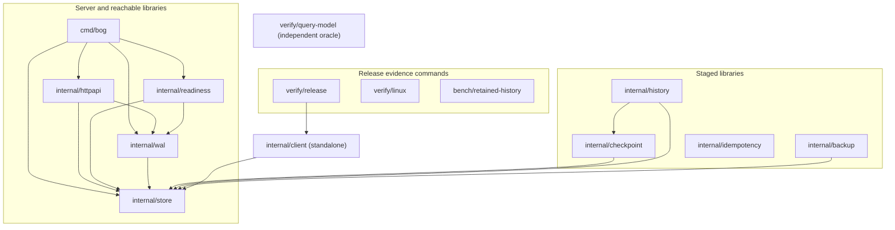

# Bog system architecture

## Deployment and consistency unit

One Linux process, one HTTP listener, one WAL owner, and one pinned local data
directory form Bog's deployment and consistency unit. `cmd/bog` acquires the
exclusive directory lock, recovers the committed state, and then opens the
listener. The owner holds the lock through HTTP drain. If drain fails, the
process exits with the WAL still open so handlers cannot race another owner.

The WAL owner controls append order and when a complete batch becomes durable
and query-visible. The service requires a trusted, service-owned local
filesystem with advisory locking, atomic rename, file and directory sync, and
powersafe overwrite. Keep each data directory under a single writer. The
listener exposes ingest and query without authentication. Deploy it on a
trusted network or behind an authenticated access layer.

## Observed Linux production imports

These direct root-module production imports were measured with
`go list -deps` at `abefdb5dcdc1f8bbbecdc9c0cc7ab39b309a87db`. Linux
amd64 (v1) and arm64 (v8.0) have the same edges with cgo disabled. This
revision includes the #59 HTTP paging seam, release-client integration,
and #63's checkpoint and history budget primitives. The command serves
the legacy storage path. Arrows point from importer to dependency. Nodes
with no outgoing arrows have zero direct root-module production imports.

- **Ingest** validates complete NDJSON batches before appending. The WAL syncs
  frames, syncs and renames the temporary commit marker over `bog.commit`,
  syncs the directory, and publishes whole batches before HTTP returns 204.
  A confirmed rollback returns 503 and publishes no rows. An uncertain commit
  or rollback poisons the writer and terminates the process on the served
  path. Recovery validates the committed prefix and discards uncommitted bytes.
- **Queries** match a case-sensitive literal within a half-open time range.
  UTC timestamp and append ordinal determine order, including ties,
  duplicates, and backfill. The command serves a replayed in-memory store
  through the legacy page source. Admission, scan work, and response bytes
  have independent limits.
- **Health** reports listener liveness at `GET /healthz` after recovery.
  `GET /ready` combines disk headroom sampled from the configured directory
  path and the terminal WAL group outcome. A rollback reports `wal_rollback`
  until a later durable outcome. An uncertain outcome reports
  `recovery_required` while the process serves. Readiness has a descriptor-backed
  sampler ready for #60's command wiring to the active WAL filesystem.
  [ADR 0005](../adr/0005-pinned-writable-recovery-authority.md#readiness-descriptor-handoff-60).
- **Recovery** at this revision opens the legacy WAL layout. Under the
  directory lock, the command rejects a directory containing `bog.backup`
  or `bog.wal.tail`. The offline backup reader validates restored images.
  [ADR 0003](../adr/0003-wal-capture-and-restored-image-startup.md) records
  the startup guard and capture design.

## Pending wiring, imports, and role changes

| Pending work | Expected wiring or role change |
| --- | --- |
| #53 retained startup, #59 paging, and live compaction | `cmd/bog` composes the retained page source, writable recovery for retained generations and verified restores, and publication through the WAL owner. Measure the command and owner edges to the retained libraries before promoting checkpoint, history, or backup. Preserve HTTP's consumer-owned paging seam. |
| #60 readiness | `cmd/bog` hands an independently opened handle to the active WAL directory to readiness. Readiness observes that filesystem and the owner's commit outcome. |
| #63 resource admission | Wire the existing checkpoint and history budgets into recovery, ingest, captures, and maintenance. Qualify configured limits in the composed release gate. [Runtime budget handoff](../../internal/history/LIMITS.md), [ADR 0010](../adr/0010-retained-resource-admission.md) |
| #67 operator verification | Register `cmd/bog-verify` and measure its direct imports. The expected dependencies are the read-only backup APIs and production Go query client. [ADR 0011](../adr/0011-operator-verification-boundary.md) |

## Retained-history handoff

At cutover, the retained adapter lives in `cmd/bog` and implements HTTP's
consumer-owned `PageSource`. HTTP owns admission, cursor authentication and
lifetime, and NDJSON framing. The WAL owner selects and activates writable
recovery state for ordinary WAL directories, retained generations, and
verified restores. The adapter reads a coordinated capture from the owner and
history catalog. Checkpoint validates and durably publishes immutable
generations. History owns generation pins, segment scans, and reclamation.
Store owns decoded tail rows and their order. Backup consumes a pinned
storage view. Checkpoint, history, and backup receive readers, bounds, and
pins through composition and must have no production import path to the WAL
owner. The packages providing storage, including the staged retry library,
stay independent of HTTP, readiness, and the Go HTTP client.

The coordinated capture binds the validated generation and exact durable,
query-visible tail under the same owner. A cursor reads the same view across
generation replacement. A fresh walk sees later committed appends. Before
issuing its first cursor, HTTP certifies that the pinned walk can reach
exhaustion at the same per-request work budget and response byte cap,
including when a continuation lowers its row limit. The cursor uses the
earlier of HTTP's maximum lifetime and any source expiry. An authenticated
cursor whose capture has expired receives 410, and admitted operations
retain their references through completion.

Writable restore establishes checkpoint and tail recovery authority before
listening, and restart selects that writable authority. The opt-in loopback
capacity control drives replacement through the same owner. Charge replay
and whole-batch append reservations before reading or writing the tail.
Charge captures, generation pins, and staging before admitting the work.
Credit tail reclaimed by compaction after durable publication and activation,
subject to references still held by admitted operations.

ADRs 0006 and 0007 are the interface contract for core engineering and
`bog-storage`. At their review, confirm deterministic replay, captured-view
expiry, reference ownership, and commit and capture ordering. ADR 0005
governs the lifecycle handoff. The owner keeps the directory pinned through
activation, publication, and storage drain. `cmd/bog` owns the separate
readiness probe handle in #60, while readiness borrows it to sample disk
headroom and observes WAL outcomes. Capture, paging, and export references
drain before storage closes. A drain deadline leaves the owner locked until
process exit.

[ADR 0004](../adr/0004-retained-history-cutover.md)
[ADR 0005](../adr/0005-pinned-writable-recovery-authority.md)
[ADR 0006](../adr/0006-fixed-budget-query-continuations.md)
[ADR 0007](../adr/0007-runtime-storage-composition.md)

## Package registry

Wired libraries are reachable from `bog/cmd/bog` in the Linux production
graph measured above. Staged libraries await runtime wiring. Standalone
libraries have independent consumers. Test-only packages have Linux test
files and no Linux production files. Verifier commands and support live
outside the server dependency tree.

| Package or entry point | Role | Responsibility |
| --- | --- | --- |
| `cmd/bog` | Server command | Recovery, listener, and lifecycle |
| `internal/httpapi` | Wired | HTTP validation, admission, cursors, and response framing |
| `internal/readiness` | Wired | Disk headroom and write outcome observation |
| `internal/wal` | Wired | Directory locking, commit, replay, and WAL capture |
| `internal/store` | Wired | Row decoding, publication, and ordered queries |
| `internal/checkpoint` | Staged | Legacy WAL scans, checkpoint format, and publication |
| `internal/history` | Staged | Generation validation, scans, pins, and reclamation |
| `internal/backup` | Staged | Pinned export, verification, restore, offline reads, and destination-scoped staging recovery |
| `internal/idempotency` | Intentionally staged | Keyed-ingest coordination and backend contract. `bog-storage` owns the durable backend. |
| `internal/client` | Standalone | Production HTTP client, complete-page framing, opaque cursor handling, and ingest outcomes |
| `internal/ingest` | Test-only | Reference decoder and fuzz tests |
| `internal/archtest` | Test-only | Linux dependency fitness suite |
| `cmd/bog-verify` | Pending operator command (#67) | Offline backup verification and complete query parity against a separately restored server |
| `verify/fuzz` | Test-only | Linux backup and history corruption harness with bounded inputs (#58) |
| `verify/release` | Verifier command | Admission and fixed-budget paging with the production client, report validation, and the restored-parity test entry point |
| `verify/linux` | Verifier command | Linux crash recovery, ENOSPC, and readiness across path retargets (#3) |
| `bench/retained-history` | Verifier command | Legacy baseline and live capacity producer (#32) |
| `verify/query-model` | Verifier support | Independent append-log oracle for ordered membership at a captured cutoff |
| `bench/segment-layout` | Nested-module benchmark | Checkpoint layout experiment outside the root-module graph |
| `.github/workflows/linux-release.yml` | Release workflow | Pins the candidate, runs the producers, and publishes evidence |

Activate keyed retries when the production WAL commits and recovers retry
records atomically with their batches and the ingest route passes concurrent
same-key submissions, conflicting bodies, and retries after an ambiguous
response and process restart. Update its registry role and direct imports
with that wiring.
[Ingest retry contract](../ingest-retries.md)

## Ranked quality attributes

| Rank | Property | Trade-off |
| --- | --- | --- |
| 1 | Durability | Wait for durable whole-batch commit before acknowledging and for durable publication before activating new authority. Stop on uncertain writes or committed corruption, even when availability suffers. Descriptor-backed readiness keeps disk signals aligned with the owner's filesystem across path retargeting. |
| 2 | Exact queries | Preserve ordered membership through restart, compaction, and verified restore. Certify the full fixed-budget walk before issuing a cursor and keep the view pinned through admitted operations. Release evidence uses fixture rows and cutoffs. Operator verification uses the verified image. |
| 3 | Bounded resources | Limit captures, concurrent scans, request work, and response bytes. Under #53 and #63, refuse whole batches and new maintenance at capacity. Pins delay reclamation, and the v1 full-WAL layout keeps the readable prefix. [ADR 0010](../adr/0010-retained-resource-admission.md) |
| 4 | Recovery time | The baseline replays the committed WAL before opening the listener. Cutover validates the checkpoint and writable authority before replaying a bounded committed suffix. |
| 5 | Throughput | Share syncs across admitted writes and prune provably irrelevant scan work. Hashing the v1 prefix for publication and export consumes disk bandwidth. |

## Operator verification boundary

`cmd/bog-verify` compares an immutable verified image with complete HTTP
query walks against a server restored to the same point. It uses the backup
reader and production Go client. The command has no write or recovery
authority over either the image or the server directory. It must have no
direct or transitive root-module production path to `internal/wal`,
`internal/httpapi`, or `internal/readiness`.
[ADR 0011](../adr/0011-operator-verification-boundary.md)

## Release evidence

#53 remains the Cycle 10 release gate. Qualify one clean revision that
composes retained-history startup, #59 paging, live compaction, #63
resource admission, and #60 descriptor-backed readiness. Build once on
native Linux amd64 and once on native Linux arm64 from the same full
commit SHA with Go 1.27.0. Each runner uses its architecture's pinned
binary for every required producer. Record runner architecture and build
identity. Each report must match the revision, that binary's SHA-256,
and the `linux-release-v1` fixture. Require all cases and cleanup to pass
on both runners. The measured revision's Ubuntu 24.04 workflow runs
on amd64. Native arm64 and the composed #63 resource evidence remain
pending for qualification.
[Linux release workflow](../../.github/workflows/linux-release.yml)

| Source | Report | Required evidence |
| --- | --- | --- |
| `verify/release` | `admission.json` | Saturated query slot, concurrent ingest, cursor resume, and clean work-budget rejection. Issuing budgets must complete tied-row and sparse, byte-trimmed walks, including a smaller resume limit. |
| `verify/linux` | `durability.json` | SIGKILL recovery, committed-prefix checks, and observed ENOSPC on a disposable local filesystem. Retarget the configured path in both directions and require readiness and ingest to follow the active WAL filesystem. |
| `bench/retained-history` | `capacity.json` | Confirm a newer durable generation at the exact requested cutoff, resume a held cursor across replacement during acknowledged backfill, and verify fresh ordered history including after restart. Run at both fixture sizes with bounded cgroup and process cleanup. |
| `verify/release` / `TestReleaseRestoredParity` | `parity.json` | Start the shipped binary on a verified restore, compare fresh HTTP walks, observe 204 for a new append, and recover the exact augmented history after restart. |
| #63 resource admission | Limit evidence | Exercise configured limits, bounded refusal of whole batches and new maintenance work, recovery when capacity returns, and preservation of admitted captures through expiry and drain. [ADR 0010](../adr/0010-retained-resource-admission.md) |

The `linux-release-evidence` artifact contains build identity, fixture and
runner details, reports, exit statuses, and logs. The Linux verifier race
step also runs the bounded backup and history corruption corpus in
`verify/fuzz` and records it in `verifier-race.log`. The legacy capacity
run records a baseline.
[Release verifier contract](../../verify/release/README.md)

`verify/release` uses `internal/client` to qualify complete NDJSON pages
and opaque continuation handling. The independent append-log model supplies
expected rows for restored parity through test imports. The production
oracle package has no root-module imports. Low-level transport probes
exercise TCP backpressure and wire-level rejection.
[ADR 0008](../adr/0008-release-verifier-composition.md)

## Fitness and registry ownership

Core engineering owns the architecture record and fitness registry, #59's
HTTP paging contract, and production-client release integration.
`bog-storage` owns #53, composes the retained adapter in `cmd/bog`, and
owns recovery and publication, including crash-safe backup staging. #60
follows the command lease handoff. The #53 composition uses the #63
admission interfaces. #67 owns registration of `cmd/bog-verify` in
`internal/archtest/architecture_test.go` alongside its command changes.
Release verifier updates have their own write scope.

After the competing lease clears, core engineering and `bog-storage` pair
with #53 to acquire write leases for `internal/archtest/architecture_test.go`
and `docs/architecture/SYSTEM.md`. Review both sides of the merge base and
measure production imports and server reachability for Linux amd64 and
arm64 on the composed tree. In the wiring change, update the measured
revision, diagram, ranked trade-offs, and package roles together with the
registry's exact imports. Promote only retained libraries reached by the
command on the measured graph and remove retired edges. Keep idempotency
staged until its durable ingest activation criteria pass.
[Fitness registry](../../internal/archtest/architecture_test.go)

The Architecture workflow runs `go test -count=1 ./internal/archtest`.
The suite lists packages for `GOOS=linux` with `GOARCH=amd64 GOAMD64=v1`
and `GOARCH=arm64 GOARM64=v8.0`. Both use `CGO_ENABLED=0 GOENV=off
GOFLAGS= GO111MODULE=on GOWORK=off`. It checks
production imports within the root module and follows all listed dependencies
for server reachability. Host-only files, test imports, and nested modules
are outside the production import registry. Package loading errors, cycles,
unregistered packages, incorrect roles, forbidden imports, and stale
registered imports fail the suite. The registry requires `verify/fuzz` to
have Linux test files only. A storage dependency on HTTP, readiness, or the
Go HTTP client fails even when it is transitive or all direct edges are
registered. Readiness may observe the WAL outcome. Direct and transitive
paths from readiness to checkpoint, history, or backup fail even when fully
registered. The composed fixtures exercise command-local wiring and
readiness bypasses. The companion paging check rejects any root-module
production path from HTTP to checkpoint, history, or backup, including a fully
registered path through an intermediate package. Its fixtures exercise
both command-owned adapter wiring and HTTP bypasses.
[Paging boundary check](../../internal/archtest/cutover_boundaries_test.go)

The storage authority check rejects direct and transitive root-module
production paths from checkpoint, history, or backup to `internal/wal`,
including paths whose edges are all registered. Its fixtures cover valid
command-local composition and bypasses through a registered intermediary.
[Storage authority check](../../internal/archtest/storage_authority_test.go)

The oracle independence check follows registered root-module production
edges from `verify/query-model` and rejects reachability to the production
client or a server command, wired library, or staged runtime library.
Fixtures run the existing registry checks on the allowed verifier-to-client
and verifier-to-oracle edges and on fully registered paths that violate
oracle independence.
[Oracle independence check](../../internal/archtest/verifier_boundaries_test.go)

The operator verification check follows the registered production graph from
`cmd/bog-verify` and rejects reachability to the WAL owner, server HTTP,
or readiness. Fixtures pass the existing registry checks with allowed
backup and client imports and with fully registered direct and transitive
violations. The real-command check runs once #67 registers the command.
[Operator boundary check](../../internal/archtest/operator_boundary_test.go)

Run `go test -count=1 ./internal/archtest` and
`GOOS=linux GOARCH=amd64 CGO_ENABLED=0 go build ./...` on the baseline and
again on the composed tree before dispatching the #53 release gate with its
full commit SHA.
