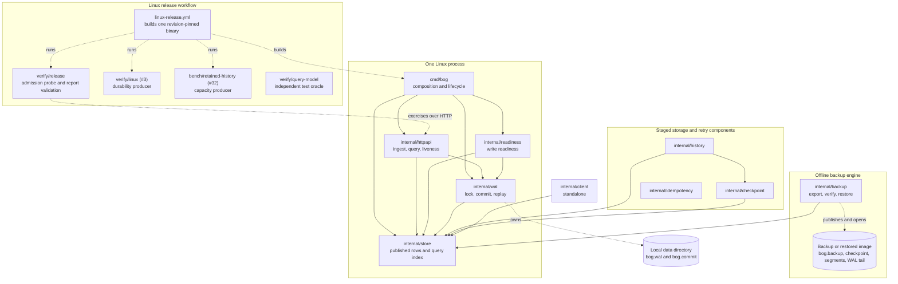
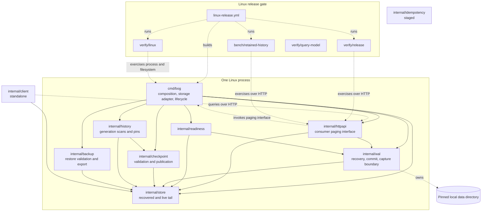

# Bog system architecture

Bog uses one Linux process, one HTTP listener, one WAL owner, and one pinned
local data directory as its deployment and consistency unit. `cmd/bog` owns
startup and shutdown. At the Cycle 38 base it constructs the in-memory store,
opens and replays the WAL before listening, and composes HTTP with readiness.
On shutdown it stops readiness probes and drains HTTP before closing the WAL.
The directory remains locked while handlers may still use it.

The WAL owns the exclusive data-directory lock, append order, and the durable
commit boundary. The deployment assumes a trusted, service-owned local
filesystem with advisory locking, atomic rename, file and directory sync, and
powersafe overwrite. The service has no built-in authentication or stream
isolation. Its HTTP listener belongs on a trusted network or behind an
authenticated access layer.

## Observed imports and entry points at the Cycle 38 base

Solid arrows show direct Go imports. Labeled dotted arrows show ownership,
file publication, or how the release workflow runs the candidate. This is
the direct root-module production graph at `17530c2`. Isolated nodes have
no direct imports of other production packages in the root module.

- **Ingest and durability** — HTTP validates the complete NDJSON request
  before appending. The WAL writes complete frames, syncs WAL bytes, and
  publishes the new committed end by syncing a temporary marker, renaming it
  over `bog.commit`, and syncing the directory. It then publishes complete
  batches to the query store before HTTP acknowledges with 204. A confirmed
  rollback publishes no rows and returns 503. An uncertain commit or rollback
  poisons the writer and the shipped HTTP path terminates the process, leaving
  the request outcome unknown. Recovery validates and replays the committed
  prefix and discards any uncommitted tail.
- **Queries** — The store holds decoded retained rows and a derived in-memory
  index. Queries match a case-sensitive literal within a half-open time range.
  They return rows by UTC timestamp and append ordinal, preserving duplicates
  and backfill. Authenticated page cursors bind the first page's published row
  count, filter and continuation position. They expire on restart. Admission,
  scan work and response bytes are bounded independently of the total
  retained rows, which still grow in memory.
- **Readiness** — `GET /healthz` reports listener liveness after recovery.
  `GET /ready` combines sampled disk headroom with the latest terminal WAL
  group outcome from `LastCommitOutcome`. The shipped server allows concurrent
  appends and the WAL worker publishes outcomes in commit order. A rollback
  reports `wal_rollback` until superseded by a durable outcome. An uncertain
  outcome reports `recovery_required` while the process is still serving. A
  recent durable outcome newer than the disk sample is evidence of readiness.
  Readiness serializes appends only for appenders without the outcome method.
- **Offline backup** — The staged engine exports, verifies, and restores a
  checkpoint and its exact committed WAL suffix. The image reader is exercised
  offline through `OpenRestored`. The shipped command currently opens the
  legacy WAL layout and rejects directories containing `bog.backup` or
  `bog.wal.tail` before legacy WAL recovery. [ADR 0003](../adr/0003-wal-capture-and-restored-image-startup.md)
  records the startup guard and capture design.
- **Release evidence** — The dispatch workflow builds one Linux candidate at
  the supplied revision and passes that binary to each evidence producer.
  `verify/release` runs the admission probe and validates the reports. #3 and
  #32 provide the durability and capacity producers. The capacity producer can
  record a legacy baseline and requires the live compaction control to qualify
  the cutover.

## Package registry

The registry in [architecture_test.go](../../internal/archtest/architecture_test.go)
records Linux production reachability and permitted direct imports within the
root Go module. Production reachability starts at `bog/cmd/bog`. The table
records observed base roles. The two observed verifier commands marked for
#54 registration already exist in the tree.

| Package or entry point | Current role | Responsibility |
| --- | --- | --- |
| `cmd/bog` | Server command | Composes the server and owns process lifecycle |
| `internal/httpapi` | Runtime | HTTP protocol, request validation, query admission, and cursor handling |
| `internal/readiness` | Runtime | Write readiness and outcome observation |
| `internal/wal` | Runtime | Directory lock, durable append, and recovery |
| `internal/store` | Runtime | Row decoding, publication, and exact ordered queries |
| `internal/checkpoint` | Staged | Offline legacy WAL scans, checkpoint format, and durable publication |
| `internal/history` | Staged | Disk-backed generation validation, scans, pins, and reclamation |
| `internal/backup` | Staged | Offline checkpoint-consistent export, verification, and restored-image reads |
| `internal/idempotency` | Staged | Coordinates retries of validated ingest batches through a backend |
| `internal/client` | Standalone | HTTP client with page validation and ingest outcome handling |
| `internal/ingest` | Test-only | Reference decoder and fuzz tests |
| `internal/archtest` | Test-only | Linux import graph fitness suite |
| `verify/release` | Verifier command | Black-box admission producer and release report validator |
| `verify/query-model` | Verifier support | Independent query oracle and fixtures used by tests |
| `bench/segment-layout` | Benchmark command in a nested Go module | Linux checkpoint layout experiment, outside the root-module graph |
| `.github/workflows/linux-release.yml` | Release workflow | Builds and identifies the candidate, runs producers, and publishes evidence |
| `verify/linux` (#3) | Verifier command, registration pending #54 | Linux crash recovery and ENOSPC durability evidence |
| `bench/retained-history` (#32) | Verifier command, registration pending #54 | Revision-pinned legacy baseline and live capacity evidence |

Runtime libraries are reachable from the server. Staged libraries are
root-module production packages awaiting runtime wiring. Standalone
libraries have independent consumers. Test-only packages contain only test
code. Verifier commands and support packages sit outside the runtime
reachability tree. The nested segment-layout module sits outside the
root-module import graph. Both pending verifier registrations have zero
direct root-module imports. See the
[release verifier contract](../../verify/release/README.md) for invocation
and report requirements.

## Intended retained-history imports at cutover

[ADR 0004](../adr/0004-retained-history-cutover.md) records the consumer
interface and ownership before implementation. This graph shows intended
direct imports. The cutover records the actual edges and roles observed in
the integrated candidate.

The composition root implements the HTTP consumer interface and wires it to
the WAL owner and history catalog. HTTP can capture and page through this
interface. The dotted call in the graph is interface dispatch. WAL,
checkpoint, history, backup, and store have no imports of HTTP or
readiness. The retained view combines a pinned checkpoint generation with
a fixed committed tail. A cursor continues to read that view across
replacement. Writable restore activation establishes recovery authority for
that same view before the listener opens. The opt-in capacity control
exercises generation replacement through the same owner and listener.

At cutover, expect `internal/checkpoint`, `internal/history`, and
`internal/backup` to become runtime libraries once the command reaches
them. Register the observed production roles and direct imports in the
same integration change. The standalone client, staged keyed-ingest
library, test-only packages, and verification producers retain their
separate entry points and roles.

## Ranked trade-offs

Higher-ranked properties govern decisions when goals conflict.

| Rank | Property | Consequence |
| --- | --- | --- |
| 1 | Durability | Acknowledge only durable complete batches. Fail startup on corrupt committed data and stop writes when commit state is uncertain. Verify crash recovery and ENOSPC against the release candidate (#3). |
| 2 | Exact query correctness | Preserve ordering, duplicates, backfill, and snapshot membership. Fail incomplete scans without advancing the cursor. A fresh walk after verified restore reproduces its captured rows. Subsequent durable appends survive restart with the same global ordering. |
| 3 | Bounded resource use | Budget query work, output bytes, concurrent scans, retained pins, and the committed tail. Use per-row positions to avoid rescanning byte-trimmed pages. Measure the legacy capacity baseline and the retained-history cutover with the same revision-pinned fixture contract (#32). |
| 4 | Recovery time | Validate the checkpoint and replay its bounded committed tail before serving restored history. Measure startup without relaxing durability checks. |
| 5 | Throughput | Share syncs across admitted writes and prune provably irrelevant query work within the guarantees above. |

## Fitness test and registry maintenance

The Architecture workflow runs `go test -count=1 ./internal/archtest` from
the root module on each pull request. The test
binary runs on the host and invokes `go list -deps -json ./...` for
`GOOS=linux GOARCH=amd64 GOAMD64=v1 CGO_ENABLED=0`. The subprocess uses
`GOENV=off GOFLAGS= GO111MODULE=on GOWORK=off` for the default module build
without caller-supplied tags or workspace overrides. It reads production
imports only. Files excluded by Linux build constraints, test imports,
dependencies outside the root module, and nested modules are outside the
direct-import rules. Transitive server reachability still follows listed
dependencies. Package loading errors, forbidden imports, cycles, unregistered
production packages, and stale role registrations fail the suite.

#54 is the sole writer of `internal/archtest/**` and coordinates producer
and runtime integration. For each integration,
find the PR's current base with
`git merge-base HEAD origin/main` using an up-to-date target ref. Review package
and import changes from that merge base on both sides. Register
`bog/verify/linux` and `bog/bench/retained-history` as verifier commands with
empty root-module import lists. The base suite currently reports both as
unregistered production packages. Land each staged-to-runtime promotion with
the wiring that makes the package reachable. Refresh the observed graph and
registry together, and remove entries for retired packages. Run
`go test -count=1 ./internal/archtest` on the composed tree before dispatching
the pinned Linux release gate.
