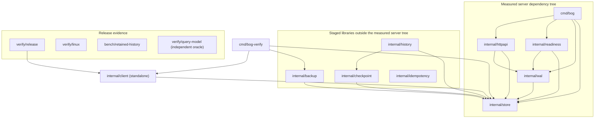

# Bog system architecture

## Deployment and consistency unit

One Linux process, one HTTP listener, one WAL owner, and one pinned local
data directory form Bog's deployment and consistency unit. `cmd/bog` opens
the listener after the owner acquires the exclusive directory lock and
recovers committed state. In the #53 composition, the same owner selects
writable recovery authority and serializes durable append visibility,
snapshot capture, and generation activation. The lock covers startup and
the drain of HTTP requests and storage work. A drain failure leaves the
owner locked until process exit.

The WAL owner orders appends and decides when a complete batch becomes
durable and query-visible. The service requires a trusted, service-owned
local filesystem with advisory locking, atomic rename, file and directory
sync, and powersafe overwrite. The ingest and query listener has no built-in
authentication. Deploy it on a trusted network or behind an authenticated
access layer. [Single-writer decision](../adr/0001-single-writer-retained-history.md)

## Observed Linux production imports

The graph was measured at Cycle 86's base,
`5fdbe223b87b3c6d22b2e9d038b8595ac09db456`. Both Linux amd64 (v1) and
arm64 (v8.0) report the same direct root-module production imports and
transitive server reachability with cgo disabled. `cmd/bog` reaches
`internal/httpapi`, `internal/readiness`, `internal/wal`, and
`internal/store` on both targets. The #53 command wiring is required to
measure the cutover graph. [Cutover measurement](../adr/0015-retained-history-runtime-cutover.md#integration-and-qualification)
Arrows point from importer to direct dependency. Nodes without outgoing
arrows have zero direct root-module production imports. The registry also
lists test-only packages.

- **Ingest.** The WAL syncs whole validated NDJSON batches, syncs and installs
  the commit marker over `bog.commit`, and syncs the directory. It publishes
  the durable rows before HTTP returns 204. A confirmed rollback returns 503
  with no rows published. An uncertain commit or rollback poisons the owner
  and terminates the served process.
- **Query.** Results match a case-sensitive literal within a half-open
  time range and are ordered by UTC timestamp and global append ordinal.
  That order preserves ties, duplicates, and backfill. The measured
  server serves a replayed in-memory store. Query concurrency, scan work,
  and encoded response bytes have independent caps.
- **Recovery.** The measured server validates and replays the committed
  ordinary WAL before listening. Under the directory lock, it rejects
  restored layouts containing `bog.backup` or `bog.wal.tail`. The offline
  backup reader validates verified images. [Restored-image startup design](../adr/0003-wal-capture-and-restored-image-startup.md)
- **Readiness.** `GET /healthz` reports listener liveness after startup.
  `GET /ready` combines disk headroom and the terminal WAL group outcome.
  A confirmed rollback reports `wal_rollback` until a later durable
  outcome. An uncertain outcome reports `recovery_required` while the
  process serves. The measured command samples by configured path. #60
  wires the existing descriptor sampler to an independently owned handle
  to the active WAL directory. [Readiness descriptor handoff](../adr/0005-pinned-writable-recovery-authority.md#readiness-descriptor-handoff-60)

## Retained-history handoff

#53 will compose the retained `PageSource` in `cmd/bog` and inject it through
`httpapi.NewWithPageSource`. HTTP owns admission, cursor authentication and
expiry, fixed-budget certification through exhaustion, and NDJSON framing.
The adapter pins the validated generation and the matching durable,
query-visible tail together under WAL owner synchronization. A held cursor
keeps its original view across replacement while fresh walks see later
commits. The earlier of the source expiry and HTTP deadline governs new
resumes. Admitted paging and export operations keep their references to
completion. Ordinary cursors remain retryable through the terminal page.
The opt-in loopback capacity control can explicitly retire the fixture's
capture after exhaustion so the fixture can measure the predecessor's pin
drain within its deadline. Retirement bars new resumes while admitted
operations drain. [Runtime cutover](../adr/0015-retained-history-runtime-cutover.md),
[Fixed-budget continuations](../adr/0006-fixed-budget-query-continuations.md)

The cutover validates ordinary WAL, retained checkpoint plus committed
suffix, and verified restore under the same pinned directory. A restored
image establishes writable authority before the listener opens. Checkpoint
validates and durably publishes immutable generations. History owns
generation scans, pins, and reclamation. Store owns decoded rows and
their order. Backup consumes pinned readers and bounds. The WAL owner
coordinates append publication, capture, and generation activation.
Checkpoint, history, and backup receive authority through composition.
[Runtime storage composition](../adr/0007-runtime-storage-composition.md),
[Pinned writable recovery](../adr/0005-pinned-writable-recovery-authority.md)

The opt-in loopback capacity control uses the same publication path.
Charge replay and whole-batch append reservations before reading or
writing the tail. Charge capture, pin, and staging capacity before doing
work. Credit reclaimed capacity after durable publication and activation
and once references to the covered data drain. Stop admitting new work
during shutdown, drain HTTP and storage work, then close storage and the
pinned directory. [Resource admission](../adr/0010-retained-resource-admission.md),
[Storage budget interfaces](../../internal/history/LIMITS.md)

## Package registry

Wired libraries are reachable from `cmd/bog` in the measured Linux
production graph. Staged libraries have a named owner and activation
criteria and await server wiring. Operator or evidence use alone leaves
that role unchanged. Standalone libraries sit outside the server tree and
must be reachable through production imports from a registered command.
The operator and evidence commands are verifier roots in the fitness
registry. Test-only packages have Linux test files and no Linux
production files. [Command root boundaries](../adr/0012-command-root-boundaries.md),
[Standalone package consumers](../adr/0014-standalone-package-consumers.md)

| Package or entry point | Role | Responsibility |
| --- | --- | --- |
| `cmd/bog` | Server command | Recovery, listener, and lifecycle |
| `internal/httpapi` | Wired | HTTP validation, admission, cursors, and response framing |
| `internal/readiness` | Wired | Disk headroom and write outcome observation |
| `internal/wal` | Wired | Directory locking, commit, replay, and WAL capture |
| `internal/store` | Wired | Row decoding, publication, and ordered queries |
| `internal/checkpoint` | Staged | WAL scans, checkpoint format, and durable publication |
| `internal/history` | Staged | Generation validation, scans, pins, and reclamation |
| `internal/backup` | Staged | Pinned export, verification, restore, offline reads, and staging recovery. The operator command uses the read-only APIs. |
| `internal/idempotency` | Staged | Keyed-ingest coordination and durable backend contract |
| `cmd/bog-verify` | Operator command | Read-only image verification and complete HTTP query parity |
| `internal/client` | Standalone | Production HTTP client for `cmd/bog-verify` and `verify/release`, including complete-page framing, opaque cursors, and ingest outcomes |
| `internal/ingest` | Test-only | Reference decoder and fuzz tests |
| `internal/archtest` | Test-only | Linux dependency fitness suite |
| `verify/fuzz` | Test-only | Bounded backup and history corruption harness |
| `verify/release` | Verifier command | Admission, fixed-budget paging, and report validation. Its test entry point produces restored-parity evidence. |
| `verify/linux` | Verifier command | Linux crash recovery, ENOSPC, and readiness across path retargets |
| `bench/retained-history` | Verifier command | Legacy baseline and live capacity evidence |
| `verify/query-model` | Verifier support | Independent append-log oracle for expected query results |
| `bench/segment-layout` | Nested-module benchmark | Checkpoint layout experiment outside the root module |
| `.github/workflows/linux-release.yml` | Release workflow | Pins the candidate, runs both native jobs, and publishes evidence |

`bog-storage` owns checkpoint, history, and backup activation in #53. For
each library reached on both Linux targets, record the direct imports in
the diagram and fitness registry, mark the library wired, and remove its
staging declaration in the runtime PR. `bog-storage` also owns idempotency
activation. Keyed retries require the
production WAL to commit and recover retry records atomically with their
batches. Exercise concurrent same-key submissions, conflicting bodies, and
retries after an ambiguous response and process restart.
[Staging declarations](../../internal/archtest/staged_packages_test.go),
[Ingest retry contract](../ingest-retries.md)

## Ranked quality attributes

| Rank | Property | Design choice and cost |
| --- | --- | --- |
| 1 | Durability | Acknowledge only durable whole batches and activate only durably published generations. Fence on uncertainty and fail startup on invalid committed authority, even when availability suffers. |
| 2 | Exact queries | Preserve timestamp and ordinal order through restart, restore, and replacement. Certification spends work before cursor issuance. Retrying a terminal page requires pinned generations and tails until expiry or explicit retirement, which delays reclamation. |
| 3 | Bounded resources | Bound query work, response bytes, and concurrency. The retained path bounds replay, whole-batch append reservations, live captures, pinned generations, and staging. Capacity pressure can defer maintenance and refuse whole batches. Release credits after durable activation and reference drain. |
| 4 | Recovery time | Ordinary WAL recovery replays the full committed prefix. Retained startup validates the generation and writable authority, then replays a bounded committed suffix. Validation adds I/O before the listener opens. |
| 5 | Throughput | Group syncs across admitted commits and prune provably irrelevant scan work. Keeping and hashing the readable v1 prefix costs disk space and bandwidth. Tail-only v1 restores keep the verified checkpoint boundary and have finite writable tail capacity. |

## Operator verification boundary

`cmd/bog-verify` consumes an immutable verified image and, for parity, a
separately restored server held at the image's recovery point. It compares
timestamp and line values in exact order through both terminal pages
using the read-only backup APIs and the production Go client. It has
read-only authority and no direct or transitive root-module production
path to `internal/wal`, `internal/httpapi`, or `internal/readiness`.
The server has no production path to the Go HTTP client or independent
query oracle. [Operator verification](../adr/0011-operator-verification-boundary.md),
[Command root boundaries](../adr/0012-command-root-boundaries.md)

## Release evidence

Qualify the same clean composed revision on native Linux amd64
(`ubuntu-24.04`, `GOAMD64=v1`) and arm64 (`ubuntu-24.04-arm`,
`GOARM64=v8.0`). Each job verifies its runner and kernel architecture,
builds once with Go 1.27.0 and cgo disabled, and uses that job's pinned
binary for every producer. Reports bind to the full revision, the native
binary's SHA-256, and the `linux-release-v1` fixture. Both matrix jobs
must pass report validation and cleanup. The matrix is configured and
qualification of the composed #53 revision is pending.
[Linux release workflow](../../.github/workflows/linux-release.yml)

| Producer | Report | Required evidence |
| --- | --- | --- |
| `verify/release` | `admission.json` | Query slot saturation, concurrent ingest, cursor replay, and clean work-budget rejection. Issuing budgets complete tied and sparse, byte-trimmed walks, including a smaller resume limit. |
| `verify/linux` | `durability.json` | SIGKILL recovery, committed-prefix checks, and real ENOSPC on a disposable local filesystem. Retarget the configured path in both directions and check readiness and ingest against the active WAL filesystem. |
| `bench/retained-history` | `capacity.json` | Both live scales (196,608 and 393,216 seed rows), each under a 128 MiB cgroup cap with swap disabled. Verify durable replacement at the exact cutoff, a held cursor across acknowledged backfill, exact fresh and restarted walks, and process and cgroup cleanup. Capture publication and retired pin drain evidence at the runtime observation points. |
| `verify/release` / `TestReleaseRestoredParity` | `parity.json` | Start the pinned binary on a verified restore, compare exact walks with the independent append-log oracle, observe 204 for new backfill, and check the held capture and exact augmented history after restart. |

The producers exercise a separate pinned server process through HTTP,
process lifecycle, and disposable filesystem fixtures. Their production
imports have no direct or transitive root-module path to the WAL owner,
server HTTP, or readiness. Test imports can construct fixtures. The
append-log oracle derives expected rows independently. Operator parity
uses the verified image as its reference.
[Release verifier composition](../adr/0008-release-verifier-composition.md),
[Release evidence process boundary](../adr/0013-release-evidence-process-boundary.md)

The workflow publishes `linux-release-evidence-amd64` and
`linux-release-evidence-arm64` with build identity, fixture and runner
details, reports, exit statuses, and logs. `verifier-race.log` includes the
bounded backup and history corruption corpus. The capacity sample
records publication at the requested cutoff. Runtime pin drain requires
a positive retired-generation pin count while the held cursor is live
and an observed zero after exhaustion and explicit retirement of the
fixture capture. Missing runtime metrics carry an
unavailable reason. Record the configured resource limits and exercise
whole-batch and maintenance refusal, recovery when capacity returns, and
expiry with admitted operations still draining.
[Capacity evidence contract](../../bench/retained-history/README.md#publication-and-pin-drain-sample-contract),
[Resource qualification](../adr/0010-retained-resource-admission.md#qualification)

## Fitness and registry ownership

Core engineering owns the architecture record and fitness registry.
`bog-storage` owns #53 recovery, publication, and command composition.
`bog-query` owns the #59 HTTP paging contract. Recheck write leases at
dispatch and at the Storage draft handoff. #60 follows the #53 command
lease. Review the measured edges and roles together with the runtime
wiring in one PR.
[Linux architecture registry](../../internal/archtest/architecture_test.go),
[Cutover handoff](../adr/0015-retained-history-runtime-cutover.md#integration-and-qualification)

The Architecture workflow runs `go test -count=1 ./internal/archtest`.
The suite lists packages with `GOOS=linux`, `GOAMD64=v1`, `GOARM64=v8.0`,
`CGO_ENABLED=0`, `GOENV=off`, empty `GOFLAGS`, `GO111MODULE=on`, and
`GOWORK=off`, once for each target. Exact imports, cycles, package kinds,
and server reachability are checked against both inventories. The
paging, storage authority, command, and oracle restrictions also traverse
the measured production graph across module boundaries. Test imports and
nested modules are outside the root-module production registry.

- HTTP owns the paging seam. It cannot reach checkpoint, history, or
  backup, even through a registered intermediary. Readiness can observe
  the WAL outcome and cannot reach retained storage packages.
  [Paging boundary](../../internal/archtest/cutover_boundaries_test.go)
- Checkpoint, history, and backup cannot reach the WAL. Storage cannot
  depend on HTTP, readiness, or the Go HTTP client.
  [Storage authority](../../internal/archtest/storage_authority_test.go)
- Command roots enforce server and operator exclusions. The oracle and the
  three release evidence roots enforce their independent dependency rules.
  [Server boundary](../../internal/archtest/command_roots_test.go),
  [Operator boundary](../../internal/archtest/operator_boundary_test.go),
  [Oracle boundary](../../internal/archtest/verifier_boundaries_test.go),
  [Release evidence boundary](../../internal/archtest/release_evidence_boundary_test.go)
- Standalone libraries require a production command consumer. Every staged
  package requires an owner and activation criteria. Declarations for
  removed or reclassified packages fail the suite.
  [Standalone consumer check](../../internal/archtest/standalone_consumers_test.go),
  [Staging declaration check](../../internal/archtest/staged_packages_test.go)
