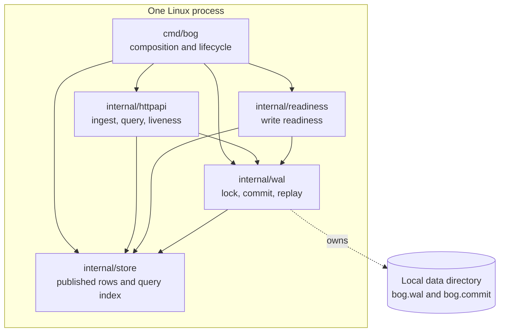

# Bog system architecture

Bog runs as one Linux process per data directory. The binary, its HTTP
listener, and the local data directory form one deployment and consistency
unit. `cmd/bog` owns startup and shutdown. It constructs the in-memory store,
opens and replays the WAL before listening, and composes HTTP with readiness.
On shutdown it stops readiness probes and drains HTTP before closing the WAL.
The directory remains locked while handlers may still use it.

The WAL owns the exclusive data-directory lock, append order, and the durable
commit boundary. The deployment assumes a trusted, service-owned local
filesystem with advisory locking, atomic rename, file and directory sync, and
powersafe overwrite. The service has no built-in authentication or stream
isolation. Its HTTP listener belongs on a trusted network or behind an
authenticated access layer.

## Current production graph

Arrows show direct Go imports between packages reached from `cmd/bog`.
The client and repository tooling run separately.

- **Ingest and durability** — HTTP validates the complete NDJSON request
  before appending. The WAL writes complete frames, syncs WAL bytes, and
  publishes the new committed end by syncing a temporary marker, renaming it
  over `bog.commit`, and syncing the directory. It then publishes complete
  batches to the query store before HTTP acknowledges with 204. A confirmed
  rollback publishes no rows and returns 503. An uncertain commit or rollback
  poisons the writer and the shipped HTTP path terminates the process, leaving
  the request outcome unknown. Recovery validates and replays the committed
  prefix and discards any uncommitted tail.
- **Queries** — The store holds decoded retained rows and a derived in-memory
  index. Queries match a case-sensitive literal within a half-open time range.
  They return rows by UTC timestamp and append ordinal, preserving duplicates
  and backfill. Authenticated page cursors bind the first page's published row
  count, filter and continuation position. They expire on restart. Admission,
  scan work and response bytes are bounded independently of the total
  retained rows, which still grow in memory.
- **Readiness** — `GET /healthz` reports listener liveness after recovery.
  `GET /ready` reports write readiness using disk headroom and recent append
  outcomes. At this revision the WAL supports grouping internally, but the
  production readiness fallback serializes appends to preserve observation
  order. The typed WAL outcome handoff in #33 and its readiness integration
  let callers submit concurrently while readiness observes outcomes in WAL
  order.

## Package registry

The registry in [architecture_test.go](../../internal/archtest/architecture_test.go)
records the current Linux production reachability and permitted direct imports
within the root Go module. Production reachability always starts at
`bog/cmd/bog`.

| Package or entry point | Current role | Responsibility |
| --- | --- | --- |
| `cmd/bog` | Server command | Composes the server and owns process lifecycle |
| `internal/httpapi` | Runtime | HTTP protocol, request validation, query admission, and cursor handling |
| `internal/readiness` | Runtime | Write readiness and outcome observation |
| `internal/wal` | Runtime | Directory lock, durable append, and recovery |
| `internal/store` | Runtime | Row decoding, publication, and exact ordered queries |
| `internal/checkpoint` | Staged | Offline legacy WAL scans, checkpoint format, and durable publication |
| `internal/history` | Staged | Disk-backed generation validation, scans, pins, and reclamation |
| `internal/client` | Standalone | HTTP client with page validation and ingest outcome handling |
| `internal/ingest` | Test-only | Reference decoder and fuzz tests |
| `internal/archtest` | Test-only | Linux import graph fitness suite |
| `verify/release` | Verifier command | Black-box admission producer and release report validator |
| `verify/query-model` | Verifier support | Independent query oracle and fixtures used by tests |
| `bench/segment-layout` | Benchmark command in a nested Go module | Linux checkpoint layout experiment, outside the root-module graph |

`cmd/bog` composes the runtime. HTTP and readiness depend on WAL and store.
WAL depends on store, which imports no Bog packages. Outside the runtime,
history may depend on checkpoint and store. Checkpoint and the standalone
client may each depend on store. The root-module verifier and query oracle
import no Bog production packages. The nested segment layout benchmark
consumes checkpoint and store in its own module. The Linux release gate
expects separate `verify/linux` (#3) and `bench/retained-history` (#32) evidence
producers on the candidate revision. Those entry points are absent at this
revision. See the [release verifier contract](../../verify/release/README.md).

## Proposed retained-history design

[ADR 0001](../adr/0001-single-writer-retained-history.md) specifies the cutover.
A production adapter will capture a pinned checkpoint generation and a fixed
committed WAL end together. HTTP paging and backup will use that same capture.
Queries will merge immutable checkpoint segments and the bounded tail in
timestamp and append order. Publication, activation, and reclamation will
respect the WAL owner's authority and outstanding pins. This cutover changes
the HTTP, checkpoint, history, and store paths together. Until then, serving
and replay use the in-memory store and legacy WAL as shown above.

## Ranked trade-offs

Higher-ranked properties govern decisions when goals conflict.

| Rank | Property | Consequence |
| --- | --- | --- |
| 1 | Durability | Acknowledge only durable complete batches. Refuse startup on corruption in committed data and stop accepting writes when commit state is uncertain. |
| 2 | Exact query correctness | Preserve ordering, duplicates, backfill, and snapshot membership. On exhausted work or read failure, fail the page rather than advancing past unverified rows. |
| 3 | Bounded resource use | Budget query work, output bytes, concurrent scans, and retained pins. Move older rows to immutable disk segments and keep WAL-tail state bounded. |
| 4 | Recovery time | Prefer validated checkpoints and bounded tail replay while keeping all durability checks. |
| 5 | Throughput | Share syncs across admitted writes and prune provably irrelevant query work within the guarantees above. |

## Fitness test and registry maintenance

From the root module, run `go test -count=1 ./internal/archtest`. The test
binary runs on the host and invokes `go list -deps -json ./...` for
`GOOS=linux GOARCH=amd64 GOAMD64=v1 CGO_ENABLED=0`. The subprocess uses
`GOENV=off GOFLAGS= GO111MODULE=on GOWORK=off` for the default module build
without caller-supplied tags or workspace overrides. It reads production
imports only. Files excluded by Linux build constraints, test imports,
dependencies outside the root module, and nested modules are outside the
direct-import rules. Transitive server reachability still follows listed
dependencies. Package loading errors, forbidden imports, cycles, unregistered
production packages, and stale role registrations fail the suite.

When integrating changes from other tracks, find the PR's current base with
`git merge-base HEAD origin/main` using an up-to-date target ref. Review package
and import changes from that merge base on both sides, then run the suite on
the integrated tree. For example, the staged `internal/idempotency` package on
the target branch needs an entry when it becomes part of this tree. Record a
new package's observed role and permitted imports in the registry and this
document. Promote a staged package in the same change that makes it reachable
from the shipped command, and remove entries for retired packages. Register
new verifier and benchmark commands as separate entry points.
