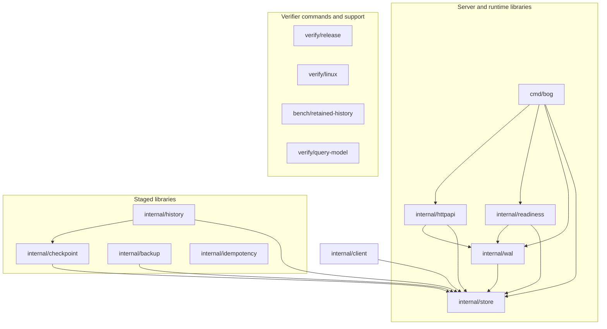

# Bog system architecture

One Linux process, one HTTP listener, one WAL owner, and one pinned local data
directory form Bog's deployment and consistency unit. `cmd/bog` acquires the
exclusive directory lock, recovers storage, and then opens the listener.
Shutdown stops readiness probes and drains HTTP before closing the WAL. The
lock remains held while handlers can use the directory.

The WAL owner controls append order and when a complete batch becomes durable
and query-visible. The service requires a trusted, service-owned local
filesystem with advisory locking, atomic rename, file and directory sync, and
powersafe overwrite. The listener has open ingest and query access. Deploy it
on a trusted network or behind an authenticated access layer.

## Observed Linux production imports

These are the direct imports between root-module production packages at
`efb5f059f5ad7ab04e3321f33c4c7a4b2f7ea605`, listed for Linux amd64 with
cgo disabled. An isolated node has zero direct root-module production imports.

- **Ingest** validates complete NDJSON batches before appending. The WAL syncs
  frames, syncs and renames the temporary commit marker over `bog.commit`,
  syncs the directory, and publishes whole batches before HTTP returns 204.
  A confirmed rollback returns 503 and publishes no rows. An uncertain commit
  or rollback poisons the writer and terminates the process on the served
  path. Recovery validates the committed prefix and discards uncommitted bytes.
- **Queries** match a case-sensitive literal within a half-open time range.
  UTC timestamp and append ordinal determine order, including ties,
  duplicates, and backfill. The base serves a replayed in-memory store.
  Admission, scan work, and response bytes have independent limits.
- **Health** reports listener liveness at `GET /healthz` after recovery.
  `GET /ready` combines sampled disk headroom and the terminal WAL group
  outcome. A rollback reports `wal_rollback` until a later durable outcome.
  An uncertain outcome reports `recovery_required` while the process serves.
- **Recovery** at this revision opens the legacy WAL layout. Under the
  directory lock, the command rejects a directory containing `bog.backup`
  or `bog.wal.tail`. The offline backup reader validates restored images.
  [ADR 0003](../adr/0003-wal-capture-and-restored-image-startup.md) records
  the startup guard and capture design.

## Retained-history integration

At cutover, the composition root wires HTTP's consumer-owned paging seam to
the WAL owner and history catalog. That is a runtime interface call from HTTP
to the supplied implementation. Checkpoint validates and durably publishes
immutable generations. History owns generation pins, segment scans, and
reclamation. Store owns decoded tail rows and their order. Backup consumes a
pinned storage view. Keep these storage packages independent of HTTP and
readiness.

The coordinated capture binds the validated generation and exact durable,
query-visible tail under the same owner. A cursor reads the same view across
generation replacement. Writable restore establishes checkpoint and tail
recovery authority before listening. The loopback capacity control drives
generation replacement through the same owner. See the interface, activation,
and launch contracts in [ADR 0004](../adr/0004-retained-history-cutover.md).

## Package registry

Runtime libraries are reachable from `bog/cmd/bog` in the Linux production
graph. Staged libraries await runtime wiring. Standalone libraries have
independent consumers. Test-only packages contain test files. Verifier
commands and support live outside the server dependency tree.

| Package or entry point | Role at the pinned revision | Responsibility |
| --- | --- | --- |
| `cmd/bog` | Server command | Recovery, listener, and lifecycle |
| `internal/httpapi` | Runtime | HTTP validation, admission, cursors, and response framing |
| `internal/readiness` | Runtime | Disk headroom and write outcome observation |
| `internal/wal` | Runtime | Directory locking, commit, replay, and WAL capture |
| `internal/store` | Runtime | Row decoding, publication, and ordered queries |
| `internal/checkpoint` | Staged | Legacy WAL scans, checkpoint format, and publication |
| `internal/history` | Staged | Generation validation, scans, pins, and reclamation |
| `internal/backup` | Staged | Pinned export, verification, restore, and offline reads |
| `internal/idempotency` | Staged | Backend-mediated keyed ingest retries |
| `internal/client` | Standalone | HTTP client, page validation, and ingest outcomes |
| `internal/ingest` | Test-only | Reference decoder and fuzz tests |
| `internal/archtest` | Test-only | Linux dependency fitness suite |
| `verify/release` | Verifier command | Admission probe and report validator, plus the restored-parity test entry point |
| `verify/linux` | Verifier command | Linux crash recovery and ENOSPC producer (#3) |
| `bench/retained-history` | Verifier command | Legacy baseline and live capacity producer (#32) |
| `verify/query-model` | Verifier support | Independent append-log oracle |
| `bench/segment-layout` | Nested-module benchmark | Checkpoint layout experiment outside the root-module graph |
| `.github/workflows/linux-release.yml` | Release workflow | Pins the candidate, runs the producers, and publishes evidence |

#54 registered both Linux verifier commands and hardened release process
lifecycle in `3afefb5`. Its Slipway review and black-box verdict cover that
change. The release qualification for a composed candidate requires its own
pinned Linux run.

## Ranked quality attributes

| Rank | Property | Consequence |
| --- | --- | --- |
| 1 | Durability | Wait for durable whole-batch commit before acknowledging. Stop on uncertain writes or committed corruption, even when availability suffers. |
| 2 | Exact queries | Preserve ordered membership through compaction, restart, and verified restore. Fail incompletely prepared pages before advancing their cursors. |
| 3 | Bounded resources | Bound captures, concurrent scans, work, response bytes, and tail size. Use per-row positions for byte-trimmed pages and reclaim only after pins drain. |
| 4 | Recovery time | Validate the authority and replay its committed suffix before opening the listener. Bound the tail to reduce recovery work. |
| 5 | Throughput | Share syncs across admitted writes and prune provably irrelevant scan work within the guarantees above. |

## Release evidence

The [Linux release workflow](../../.github/workflows/linux-release.yml)
builds one clean Go 1.27.0 candidate on Ubuntu 24.04 amd64 from the supplied
full SHA and supplies the same binary to four evidence sources. Every report
must match the revision, binary SHA-256, and `linux-release-v1` fixture.

| Source | Report | Required evidence |
| --- | --- | --- |
| `verify/release` | `admission.json` | Saturated query slot, concurrent ingest, cursor resume, and clean work-budget failure |
| `verify/linux` | `durability.json` | SIGKILL recovery, committed-prefix checks, and observed ENOSPC on a disposable local filesystem |
| `bench/retained-history` | `capacity.json` | Live compaction and full query walks across restart at both fixture sizes, with bounded cgroup and process cleanup required for cutover under #57 |
| `verify/release` / `TestReleaseRestoredParity` | `parity.json` | Fresh HTTP walks on a verified restore, a durable append, and parity after restart |

The `linux-release-evidence` artifact contains build identity, fixture and
runner details, reports, exit statuses, and logs. The legacy capacity run
records a baseline. See the [release verifier contract](../../verify/release/README.md).

## Fitness and registry ownership

The architecture PR is the sole writer of the [fitness registry](../../internal/archtest/architecture_test.go).
At integration, use `git merge-base HEAD origin/main` with the current target
ref and review package changes on both sides. Inspect the composed Linux
production graph with #53 and #13 together. Promote checkpoint, history,
and backup when the command first reaches them, register any extracted
adapter with its observed role and imports, and remove retired entries
and edges in that same change. The composed-cutover fixture exercises
these rules ahead of wiring.

The Architecture workflow runs `go test -count=1 ./internal/archtest` on the
host. The suite lists packages with `GOOS=linux GOARCH=amd64 GOAMD64=v1
CGO_ENABLED=0` and `GOENV=off GOFLAGS= GO111MODULE=on GOWORK=off`. It checks
production imports within the root module and follows all listed dependencies
for server reachability. Host-only files, test imports, and nested modules
are outside the production import registry. Package loading errors, cycles,
unregistered packages, incorrect roles, forbidden imports, and stale
registered imports fail the suite. Run it on the composed tree and compile
that tree with `GOOS=linux GOARCH=amd64 CGO_ENABLED=0 go build ./...` before
dispatching release qualification.
