# Bog system architecture

## Deployment and consistency unit

One Linux process, one HTTP listener, one WAL owner, and one pinned local
data directory form Bog's deployment and consistency unit. `cmd/bog` opens
the listener after the owner acquires the exclusive directory lock and
recovers committed state. The owner holds the lock through HTTP drain. A
drain failure leaves the WAL open and locked until process exit. The #108
design adds retained recovery, paging, and maintenance within this same
process and directory lock.

The WAL owner orders appends and decides when a complete batch becomes
durable and query-visible. The service requires a trusted, service-owned
local filesystem with advisory locking, atomic rename, file and directory
sync, and powersafe overwrite. The ingest and query listener has no built-in
authentication. Deploy it on a trusted network or behind an authenticated
access layer. [Single-writer decision](../adr/0001-single-writer-retained-history.md)

The Linux amd64 and arm64 production inventories at
`cde0efe7ec7b037ef0fae856b52aa0b0a514dc4d` agree on the 20 root-module
production packages and 23 direct imports between them shown below.
The entire root-module closure of `cmd/bog` consists of the command plus
`internal/httpapi`, `internal/readiness`, `internal/store`, and
`internal/wal`. Those four libraries are also the command's exact direct
root-module imports. The command recovers an ordinary WAL into an in-memory
store. Writable restore, live replacement, and retained paging await the
reviewed #108 Storage handoff.
[Retained-history runtime cutover](../adr/0015-retained-history-runtime-cutover.md),
[Retained runtime promotion](../adr/0049-retained-runtime-promotion.md)

## Declared Linux production import graph

The Mermaid graph declares the production packages and direct root-module
imports in the executable fitness registry. Arrows point from importer to
direct dependency. Nodes with no outgoing arrows have zero direct
root-module production imports. Test-only packages appear in the package
table below. Runtime contains the registered production closure rooted at
`cmd/bog`. Staged contains all libraries with the staged role, including
backup, which the operator command imports. The architecture suite checks
both memberships and the exact graph against the registry and checks the
registry against both Linux production inventories.

The declaration includes the fixture-backed stream policy verifier support
added in #86, both #87 capacity evidence imports, and the staged #137
stream-policy decision engine. The engine and the conformance verifier
each have zero direct root-module production imports. The shared validator
and directory-anchored publisher are present in the repository. #87
qualification still requires running the strict evidence gate against the
composed #108 runtime on both native Linux runners.
[Shared capacity evidence boundary](../adr/0020-shared-capacity-evidence.md)

```mermaid
flowchart TD
    subgraph Runtime["Measured server production closure on Linux amd64 and arm64"]
        Cmd["cmd/bog"]
        HTTP["internal/httpapi"]
        Ready["internal/readiness"]
        WAL["internal/wal"]
        Store["internal/store"]
        Cmd --> HTTP
        Cmd --> Ready
        Cmd --> WAL
        Cmd --> Store
        HTTP --> WAL
        HTTP --> Store
        Ready --> WAL
        Ready --> Store
        WAL --> Store
    end
    Operator["cmd/bog-verify"]
    Export["cmd/bog-export"]
    subgraph Staged["Libraries awaiting server activation"]
        Checkpoint["internal/checkpoint"]
        History["internal/history"]
        Backup["internal/backup (also used offline)"]
        Idempotency["internal/idempotency (staged keyed ingest)"]
        PolicyEngine["internal/streampolicy (staged decision engine)"]
        History --> Checkpoint
    end
    Client["internal/client (standalone)"]
    Checkpoint --> Store
    History --> Store
    Backup --> Store
    Operator --> Backup
    Operator --> Client
    Operator --> Store
    Export --> Client
    Client --> Store
    subgraph Evidence["Release evidence"]
        Admission["verify/release"]
        Durability["verify/linux"]
        Capacity["bench/retained-history"]
        CapacityEvidence["verify/capacityevidence"]
        Listener["verify/listener"]
        Model["verify/query-model (independent oracle)"]
        StreamPolicy["verify/stream-policy (fixture conformance)"]
        Admission --> Listener
        Capacity --> Listener
        Admission --> CapacityEvidence
        Capacity --> CapacityEvidence
    end
    Admission --> Client
```

- **Ingest.** The WAL syncs whole validated NDJSON batches, syncs and installs
  the commit marker over `bog.commit`, and syncs the directory. It publishes
  the durable rows before HTTP returns 204. A confirmed rollback returns 503
  with no rows published. An uncertain commit or rollback poisons the owner
  and terminates the served process.
- **Query.** Results match a case-sensitive literal within a half-open
  time range and are ordered by UTC timestamp and global append ordinal.
  That order preserves ties, duplicates, and backfill. The measured
  server builds the replayed store in `cmd/bog.run` and passes it through
  `newReadyHandler` to `httpapi.NewWithQueryLimits`, which wraps it in the
  legacy page source. Query concurrency, scan work, and encoded response
  bytes have independent caps.
- **Recovery.** The measured server validates and replays the committed
  ordinary WAL before listening. Under the directory lock, it rejects
  restored layouts containing `bog.backup` or `bog.wal.tail`. The offline
  backup reader validates verified images. [Restored-image startup design](../adr/0003-wal-capture-and-restored-image-startup.md)
- **Readiness.** `GET /healthz` reports listener liveness after startup.
  `GET /ready` combines disk headroom and the terminal WAL group outcome.
  A confirmed rollback reports `wal_rollback` until a later durable
  outcome. An uncertain outcome reports `recovery_required` while the
  process serves. The measured command passes `c.dir` to
  `readiness.NewHandler`, which uses path-based `Statfs`. It cancels
  probes before `http.Server.Shutdown` and calls `wal.Log.Close` after a
  successful HTTP drain. WAL close waits for its running commit group
  before closing the files and pinned directory.
  [Readiness descriptor handoff](../adr/0005-pinned-writable-recovery-authority.md#readiness-descriptor-handoff-60)

## Retained-history handoff

#108 must compose the retained `PageSource` in `cmd/bog` and inject it
through `httpapi.NewWithPageSource`. Core Query (`bog-query`) owns the HTTP
paging contract, including admission, cursor authentication and expiry, fixed-budget
certification through exhaustion, and NDJSON framing.
The adapter pins the validated generation and the matching durable,
query-visible suffix together under WAL owner synchronization. At the
measured revision, `wal.Log.Capture` pins the published WAL prefix, its
exclusive byte end, and next append ordinal under the WAL mutex. The
reviewed wiring must show how the command selects the matching
generation and suffix bounds in the same synchronization scope as append
publication and activation. A held cursor
keeps its original view across replacement while fresh walks see later
commits. The earlier of the source expiry and HTTP deadline governs new
resumes. Admitted paging and export operations keep their references to
completion. [Runtime cutover](../adr/0015-retained-history-runtime-cutover.md),
[Fixed-budget continuations](../adr/0006-fixed-budget-query-continuations.md)

At cutover, `cmd/bog` must classify and validate ordinary WAL, retained
checkpoint plus committed suffix, and verified restore under the same
pinned directory. It establishes durable writable authority for restored
images before listening. Checkpoint validates and durably publishes
immutable generations. History owns generation scans, pins, and
reclamation. Store owns decoded rows and their order. The command uses
the WAL owner's synchronization to supply checkpoint and backup with a
pinned recovery view of the generation and its exact committed suffix.
The command and WAL owner coordinate append publication and activation.
The durable selector must identify the validated successor before the WAL
owner activates it. An uncertain publication fences new writes. Readers
admitted on the old view can finish while reclamation waits for their pins.
Command-local adapters implement the separate backup and checkpoint
`RecoveryView` contracts. Backup validates its own view for export and
offline verification. History may reuse checkpoint validation. The caller
holds the operation pin through cleanup, and the consumers close their
independent readers. Reclamation waits for durable selection and final
reference drain.
[Runtime storage composition](../adr/0007-runtime-storage-composition.md),
[Pinned writable recovery](../adr/0005-pinned-writable-recovery-authority.md),
[Tail-only recovery view](../adr/0035-tail-only-retained-recovery-contract.md),
[Independent recovery-view consumers](../adr/0037-independent-recovery-view-consumers.md)

At cutover, the command passes an independently opened, unlocked handle
to `readiness.NewHandlerForDirectory`. Open it relative to the locked WAL
directory so `Fstatfs` still samples the active filesystem after the
configured path is retargeted. An independent open gives probes a
separate file description from the locked one.

The cutover's opt-in loopback capacity control uses the same publication path.
Charge replay and whole-batch append reservations before reading or
writing the tail. Charge capture, pin, and staging capacity before doing
work. Credit reclaimed capacity after durable publication and activation
and once references to the covered data drain. Stop admitting new work
during shutdown and cancel readiness sampling before closing the probe
handle. Drain HTTP, then close the HTTP API to retire captures and wait
for admitted readers and source releases. Drain storage work before
closing the WAL owner and releasing the directory lock. Review cleanup
on startup failure and lock retention on failed drain.
[Query delivery and shutdown](../adr/0039-query-delivery-and-retained-cutover.md),
[Resource admission](../adr/0010-retained-resource-admission.md),
[Storage budget interfaces](../../internal/history/LIMITS.md)

## Package registry

Wired libraries are reachable from `cmd/bog` in the measured Linux
production graph. Staged libraries have a named owner and activation
criteria and await server wiring. Operator or evidence use alone leaves
that role unchanged. Standalone libraries sit outside the server tree and
must be reachable through production imports from a registered command.
Operator and evidence commands share the verifier role in the fitness
registry. Evidence commands establish production ownership of verifier
support packages. Test-only packages have Linux test files and no Linux
production files. [Command root boundaries](../adr/0012-command-root-boundaries.md),
[Standalone package consumers](../adr/0014-standalone-package-consumers.md)

| Package or entry point | Role | Responsibility |
| --- | --- | --- |
| `cmd/bog` | Server command | Ordinary WAL recovery, listener, and lifecycle. Owns retained composition at #108 cutover. |
| `internal/httpapi` | Wired | HTTP validation, admission, cursors, and response framing |
| `internal/readiness` | Wired | Disk headroom and write outcome observation |
| `internal/wal` | Wired | Pinned directory locking, commit, replay, and published-prefix capture |
| `internal/store` | Wired | Row decoding, publication, and ordered queries |
| `internal/checkpoint` | Staged | Checkpoint format, bounded WAL scans, and durable generation publication |
| `internal/history` | Staged | Generation validation, ordered scans, pins, and reclamation |
| `internal/backup` | Staged | Pinned export, verification, restore, offline reads, and staging recovery. `cmd/bog-verify` keeps its direct offline dependency through promotion. |
| `internal/idempotency` | Staged | Keyed-ingest coordination and durable backend contract |
| `internal/streampolicy` | Staged | Policy revision activation, operation grants, and stream-local redaction and masking |
| `cmd/bog-verify` | Operator command | Read-only image verification and complete HTTP query parity |
| `cmd/bog-export` | Operator command | Stream ordered NDJSON from the server's HTTP query API |
| `internal/client` | Standalone | Production HTTP client for `cmd/bog-verify`, `cmd/bog-export`, and `verify/release`, including complete-page framing, opaque cursors, and ingest outcomes |
| `internal/ingest` | Test-only | Reference decoder and fuzz tests |
| `internal/archtest` | Test-only | Linux dependency fitness suite |
| `verify/fuzz` | Test-only | Bounded backup and history corruption harness |
| `verify/release` | Verifier command | Admission, fixed-budget paging, and report validation. Its test entry point produces restored-parity evidence. |
| `verify/linux` | Verifier command | Linux crash recovery, ENOSPC, and readiness across path retargets |
| `bench/retained-history` | Verifier command | Legacy baseline and live capacity evidence |
| `verify/capacityevidence` | Verifier support | Shared strict schema-v1 live capacity proof for release and capacity |
| `verify/listener` | Verifier support | Linux IPv4 loopback listener ownership for release and capacity |
| `verify/query-model` | Verifier support | Independent append-log oracle for expected query results |
| `verify/stream-policy` | Verifier support | Fixture-backed checks of stream isolation and pre-append redaction |
| `bench/segment-layout` | Nested-module benchmark | Checkpoint layout experiment outside the root module |
| `.github/workflows/linux-release.yml` | Release workflow | Pins the candidate, runs both native jobs, and publishes evidence |

`bog-storage` owns #108 activation for checkpoint, history, and backup.
Both measured Linux closures leave all three staged. Promote each library
in the command wiring PR once both Linux inventories of the reviewed
Storage SHA confirm server reachability and Storage supplies the activation
evidence required by ADR 0049.
Idempotency remains staged under its own criteria. Keyed retries require
the production WAL to commit and recover retry records atomically with
their batches. Exercise concurrent same-key submissions, conflicting
bodies, and retries after an ambiguous response and process restart.
[Retained runtime promotion](../adr/0049-retained-runtime-promotion.md),
[Staging declarations](../../internal/archtest/staged_packages_test.go),
[Ingest retry contract](../ingest-retries.md)

## Ranked quality attributes

| Rank | Property | Measured server | #108 decision and cost |
| --- | --- | --- | --- |
| 1 | Durability | Acknowledge whole batches after durable commit and fence on uncertain WAL outcomes. | Sync the successor and durably select it before activation. Preserve whole-batch acknowledgments across selection and writable restore. Fencing during uncertain publication costs write availability. |
| 2 | Exact queries | Preserve timestamp and append ordinal order in memory and through ordinary WAL replay. | Pin a generation and its exact committed suffix together. Merge by UTC timestamp and append ordinal through compaction and restart. Certification spends work before cursor issuance. Retiring a cursor stops new resumes, and admitted users can keep predecessor storage charged until the last reference drains. |
| 3 | Bounded resources | Cap query work, response bytes, and concurrency. | Reserve replay, whole-batch ingest, capture, pin, and staging capacity before work. Capacity pressure can defer maintenance and refuse whole batches while admitted work drains. Verify both live scales under 128 MiB with swap disabled on each native architecture. |
| 4 | Recovery time | Replay the full committed ordinary WAL before listening. | Validate the selected generation and writable authority, then replay its bounded committed suffix. Manifest, segment, and suffix validation adds startup I/O. |
| 5 | Throughput | Group syncs across admitted commits. | Prune provably irrelevant scans and serialize activation with appends. Keeping and hashing the readable v1 WAL prefix costs disk space and I/O. A verified tail-only v1 restore has finite writable tail capacity. |

## Operator verification boundary

`cmd/bog-verify` consumes an immutable verified image and, for parity, a
separately restored server held at the image's recovery point. It compares
timestamp and line values in exact order through both terminal pages
using the read-only backup APIs and the production Go client. Its
authority is limited to reading the immutable image and querying the
separate server. The server owns writable recovery and publication.
The operator command has no direct or transitive root-module production
path to `internal/wal`, `internal/httpapi`, or `internal/readiness`.
The server has no production path to the Go HTTP client or independent
query oracle. [Operator verification](../adr/0011-operator-verification-boundary.md),
[Command root boundaries](../adr/0012-command-root-boundaries.md)

## Operator export boundary

`cmd/bog-export` streams NDJSON from a snapshot query against the issuing
server. It follows opaque continuations with the original time range and
literal filter, preserving server order, timestamp ties, and duplicates.
Its only direct root-module production import is `internal/client`, which
uses `internal/store` for shared row types. Direct and transitive imports
to the server command, HTTP, readiness, WAL, backup, checkpoint, history,
idempotency, and packages at or under `verify` and `bench` are forbidden.
The walk uses one overall timeout and a finite page budget. The exporter
returns success after writing the terminal page. A walk or write failure
returns nonzero, and previously emitted complete rows form a partial export.
Release qualification uses the pinned candidate and its own evidence
producers. [Operator export boundary](../adr/0032-operator-export-boundary.md)

## Release evidence

Qualify the same clean composed revision on native Linux amd64
(`ubuntu-24.04`, `GOAMD64=v1`) and arm64 (`ubuntu-24.04-arm`,
`GOARM64=v8.0`). Each job verifies its runner and kernel architecture,
builds once with Go 1.27.0 and cgo disabled, and uses that job's pinned
binary for every producer. The workflow checks out the candidate and
the release gate at their respective pinned revisions. Reports bind to
the full candidate revision, the native binary's SHA-256, and the
`linux-release-v1` fixture. Both matrix jobs must pass strict report
validation and cleanup. Qualification of the composed #108 revision is
pending the reviewed Storage handoff and both native verdicts. Release
Verification owns the gate and the #130 retirement and #131 report
publication evidence tracks. The workflow SHA pins the producer-manifest
and Go test-event checker, and the workflow supplies the expectations for
each job.
[Linux release workflow](../../.github/workflows/linux-release.yml),
[Release gate evidence checks](../adr/0048-release-gate-evidence-checks.md)

| Producer | Report | Required evidence |
| --- | --- | --- |
| `verify/release` | `admission.json` | Query slot saturation, concurrent ingest, cursor replay, and clean work-budget rejection. Issuing budgets complete tied and sparse, byte-trimmed walks, including a smaller resume limit. |
| `verify/linux` | `durability.json` | SIGKILL recovery, committed-prefix checks, and real ENOSPC on a disposable local filesystem. Retarget the configured path in both directions and check readiness and ingest against the active WAL filesystem. |
| `bench/retained-history` | `capacity.json` | Both live scales (196,608 and 393,216 seed rows), each under a 128 MiB cgroup cap with swap disabled. Verify durable replacement at the exact cutoff, a held cursor across acknowledged backfill, exact fresh and restarted walks, and process and cgroup cleanup. Capture publication and retired pin drain evidence at the runtime observation points. |
| `verify/release` / `TestReleaseRestoredParity` | `parity.json` | Record ordinary WAL reopen, restored parity, immediate post-ack crash, and two-cycle tail-only parity as four outcomes in the existing candidate-bound report. |
| `verify/release` / `TestReleaseFixedBudgetBackfill` and `TestReleaseCapacityControlScope` | Passing test events | Exercise fixed-budget paging through backfill and replacement. Check that capacity routes are available only with explicit opt-in on the loopback listener. |
| `verify/query-model` / `TestPinnedQueryModelReplay` | `query-model-events.jsonl` | Require passing seeded ordinary and retained walks, exact terminal replay, and a candidate identity matching the revision and binary checksum on each runner. |

Strict cutover validation requires all four `parity.json` outcomes on each
native runner. Every recovery walk compares exact order and multiplicity
through exhaustion with the independent append-log oracle.

| Outcome | Required evidence |
| --- | --- |
| `ordinary_wal_reopen` | Reopen a seeded ordinary WAL, require HTTP 204 for a backfill batch, and verify the exact augmented walk before shutdown and after restart. |
| `restored_parity` | Start on a verified restore, require HTTP 204 for backfill, and verify both the held capture and fresh augmented walks. After crash and restart, check the exact augmented history and rejection of the pre-crash cursor. |
| `post_restore_ack_crash` | On a separate verified restore, send SIGKILL immediately on HTTP 204, before reading or closing the response body. Verify the signal, exact restart replay, both processes reaped, and fixture removal. |
| `tail_only_two_cycle_parity` | Start from a verified v1 restore with a nonempty tail and carry a nonempty suffix through each exact cutoff. Check held, fresh, restarted, and separately restored walks, v2 export and restore, generation and suffix digests, logical bounds, and physical tail rebasing. Verify the recovered next ordinal and use the first export as the second cycle's input. |

[Recovery parity contract](../../verify/release/README.md),
[Immediate post-restore crash evidence](../adr/0027-immediate-post-restore-crash-evidence.md)

The baseline includes query replay startup checks for verified bind
collisions. For the measured baseline with this architecture update,
both Linux inventories, portable architecture vet and race checks, and
the Linux amd64 cross-build pass. Release Verification needs the clean
composed #108 SHA as the workflow's `revision` input. Native qualification
remains pending on both amd64 and arm64.

The three producers exercise a separate pinned server process through HTTP,
process lifecycle, and disposable filesystem fixtures. Their Linux production
imports have no direct or transitive root-module path to `internal/wal`,
`internal/httpapi`, `internal/readiness`, `internal/checkpoint`,
`internal/history`, or `internal/backup`. The exclusions apply through
registered intermediaries and external dependencies and continue to apply
after retained libraries are wired into the server. Producers may use the
production HTTP client and shared row types. Test imports may use server
and storage packages to construct fixtures. Restored-parity evidence
comes from the pinned candidate and the independent append-log oracle.
Operator parity uses the verified image as its reference.
[Release verifier composition](../adr/0008-release-verifier-composition.md),
[Release evidence process boundary](../adr/0013-release-evidence-process-boundary.md),
[Retained storage boundary for release evidence](../adr/0021-retained-release-evidence-boundary.md),
[Release evidence fitness test](../../internal/archtest/release_evidence_boundary_test.go)

Release and capacity each verify listener ownership around the startup
HTTP probe and at workload completion. Capacity repeats the checks after
restart using the new child PID. The workflow records restored-parity
producer success only after an explicit passing test event and a
nonempty report. [Candidate listener ownership](../adr/0017-release-candidate-listener-ownership.md)

The benchmark's `-validate-cutover` and release's `validate -require-cutover`
use one strict schema-v1 capacity validator. The proof requires a numeric
zero in the raw cgroup OOM kill counter and validates the observed
backfill timeline in execution order. Standard release validation still
accepts historical schema-v1 live reports. Release validation matches
the pinned candidate identity across evidence reports. Release report
publication anchors staging, replacement, cleanup, and directory sync to
the same opened parent.
[Capacity evidence validation](../adr/0018-capacity-evidence-validation.md),
[Shared capacity evidence boundary](../adr/0020-shared-capacity-evidence.md)

The workflow publishes `linux-release-evidence-amd64` and
`linux-release-evidence-arm64` with build identity, fixture and runner
details, reports, exit statuses, and logs. `verifier-race.log` includes the
bounded backup and history corruption corpus. The capacity sample
records publication at the requested cutoff. Runtime pin drain requires
a positive retired-generation pin count while the held cursor is live
and an observed zero after explicit retirement and drain. The
`verify/release` retirement fixture exercises the reclamation check with
two admitted readers, explicit cursor retirement, and a rejected new
resume. It checks that after the first reader drains the predecessor
artifact and candidate descriptor remain pinned, then checks that the
last reader's completion removes both while preserving successor
artifacts. The deliberate-pin and missing-reader cases exercise rejection
and bounded teardown. Native qualification still requires the composed
candidate's observed behavior. Missing runtime metrics carry an
unavailable reason. Record the configured resource limits and exercise
whole-batch and maintenance refusal, recovery when capacity returns, and
expiry with admitted operations still draining.
[Capacity evidence contract](../../bench/retained-history/README.md#publication-and-pin-drain-sample-contract),
[Retirement fixture](../../verify/release/retirement_linux_test.go),
[Resource qualification](../adr/0010-retained-resource-admission.md#qualification)

## Stream policy conformance

The #137 decision engine remains staged under Core Engineering ownership.
Its serving integration must pass ADR 0050's independent native evidence
for scoped admission and paging, durable redaction and replay, export and
writable restore, and scoped retry wherever keyed ingest is enabled.
Security Verification owns the fixture-backed runner for the proposed
shared-deployment contract. It compares authorized query and cursor results,
retry outcomes, committed bytes and replayed records, and scoped export
evidence. Positive controls require exact retained values and durable byte
witnesses. Missing adapter evidence leaves conformance incomplete. This
milestone runs against deterministic synthetic adapters. Live server
qualification requires adapters that observe a shared-deployment implementation.
[Decision boundary and activation criteria](../adr/0050-stream-policy-decision-boundary.md),
[Proposed stream authorization and durable redaction contract](../shared-deployment/stream-authorization-redaction.md),
[Runner and adapter contract](../../verify/stream-policy/README.md)

## Fitness and registry ownership

Core Architecture in the bog AgentSet owns the architecture record and
fitness registry, including the diagram and constructor checks.
`bog-storage` owns #108 recovery, publication, and command composition.
Core Query owns the HTTP paging contract. Core Engineering must name the
query execution and security integration owners within `bog`. Release
Verification owns the native Linux amd64 and arm64 verdicts for the same
composed revision. #108 remains the release gate.
[Linux architecture registry](../../internal/archtest/architecture_test.go),
[Cutover handoff](../adr/0015-retained-history-runtime-cutover.md#integration-and-qualification),
[Tail-only recovery contract](../adr/0035-tail-only-retained-recovery-contract.md)

The constructor fitness guard landed in `b27b41ff9fcd46f3497725b052075e8353a0ede7`.
Storage carries #47 and #15 in #108 and coordinates role promotion with
Core Architecture in the reviewed command wiring PR. Recheck write leases
at dispatch and at the Storage handoff. At the reviewed Storage SHA,
compare both Linux inventories and rerun the architecture suite. Verify the
write leases cover the composition and architecture files before landing
the combined change. The wiring PR updates
`internal/archtest/architecture_test.go` with the exact
imports and roles, `internal/archtest/staged_packages_test.go` with the
remaining staging declarations, and `docs/architecture/SYSTEM.md` with the
measured revision, diagram, and role table. Preserve the operator backup
edge, the exporter and release evidence registrations, and the separate
staged stream-policy registration.
Require the architecture suite to pass on the combined revision before
merging the wiring PR.
[Landed constructor guard](https://github.com/tflynn3/bog/commit/b27b41ff9fcd46f3497725b052075e8353a0ede7),
[Package role governance](../adr/0019-package-role-governance.md),
[Retained runtime promotion](../adr/0049-retained-runtime-promotion.md),
[Exporter integration handoff](../adr/0032-operator-export-boundary.md#integration-and-qualification)

At promotion, Storage traces the serving `PageSource` to the command-owned
adapter that pins the validated generation and exact durable, query-visible
WAL suffix under the owner's synchronization. Core Engineering reviews
paging and capture release after the final reference drains. Storage also
traces readiness to a fresh, unlocked open relative to the pinned WAL
directory and verifies that the command cancels probes before closing the
descriptor. Release Verification still needs exact held, fresh, and restart
walks across replacement and acknowledged backfill, plus readiness and
ingest against the active WAL filesystem after path retargets in both
directions, on the same composed revision on both native Linux targets.
[Promotion evidence](../adr/0040-retained-runtime-constructor-boundary.md#runtime-evidence),
[Native release evidence](#release-evidence)

The Architecture workflow runs `go test -count=1 ./internal/archtest`.
The suite lists packages with `GOOS=linux`, `GOAMD64=v1`, `GOARM64=v8.0`,
`CGO_ENABLED=0`, `GOENV=off`, empty `GOFLAGS`, `GO111MODULE=on`, and
`GOWORK=off`, once for each target. Exact imports, cycles, package kinds,
and server reachability are checked against both inventories. Each direct
production edge has one registry declaration. The diagram
fitness test checks every declared production node and directed edge, the
Runtime closure, and Staged membership against the same registry. Test
imports and nested modules are outside the root-module production registry.
Boundary checks walk declared imports and each measured Linux graph
independently. The measured walk also follows external production imports.
[Diagram fitness test](../../internal/archtest/system_diagram_test.go)

- When any of checkpoint, history, or backup has the runtime library role
  or appears in the measured server closure, `cmd/bog` must reference
  `readiness.NewHandlerForDirectory` and exclude `readiness.NewHandler`.
  When history meets either condition, `cmd/bog` must
  also reference `httpapi.NewWithPageSource` and exclude `httpapi.New`,
  `httpapi.NewWithQueryMaxResponseBytes`, and `httpapi.NewWithQueryLimits`.
  The typed scan checks the selected production Go files independently
  for Linux amd64 and arm64. The fully staged baseline may use the
  compatibility constructors.
  [Constructor boundary](../adr/0040-retained-runtime-constructor-boundary.md),
  [Constructor fitness test](../../internal/archtest/retained_runtime_wiring_test.go)
- HTTP owns the paging seam. It cannot reach checkpoint, history, or
  backup, even through a registered intermediary. Readiness can observe
  the WAL outcome and cannot reach retained storage packages.
  [Paging boundary](../../internal/archtest/cutover_boundaries_test.go)
- Checkpoint, history, and backup cannot reach the WAL. Storage cannot
  depend on HTTP, readiness, or the Go HTTP client. Only `cmd/bog` may
  reach both WAL and any retained storage library, including through a
  relay. The Linux inventory checks the paging and storage authority
  boundaries through external dependencies as well.
  [Storage authority](../../internal/archtest/storage_authority_test.go)
- Backup and checkpoint/history have no production import paths to each
  other in either Linux inventory, including through relays. History can
  import checkpoint, and the offline operator can import backup.
  [Recovery-view fitness fixtures](../../internal/archtest/recovery_view_boundary_test.go)
- Command roots enforce server, operator verification, and operator export
  exclusions. The measured Linux graph checks those exclusions and the
  oracle and three release producer boundaries through external production
  dependencies as well. Both the registry and measured Linux graphs require
  the operator's direct backup edge for offline verification.
  [Server boundary](../../internal/archtest/command_roots_test.go),
  [Operator boundary](../../internal/archtest/operator_boundary_test.go),
  [Exporter boundary](../../internal/archtest/export_boundary_test.go),
  [Oracle boundary](../../internal/archtest/verifier_boundaries_test.go),
  [Release evidence boundary](../../internal/archtest/release_evidence_boundary_test.go)
- Stream policy conformance runs outside every registered production command
  dependency tree. Its own production imports cannot reach internal packages
  or command roots, including through external production dependencies.
  [Stream policy boundary](../../internal/archtest/stream_policy_boundary_test.go)
- The release and capacity producers are the only production consumers of
  the listener helper. The check follows indirect imports as well.
  [Candidate listener boundary](../../internal/archtest/listener_boundary_test.go)
- `verify/release` and `bench/retained-history` must both import
  `verify/capacityevidence` directly in production. The helper has no
  root-module production imports. The check rejects production reachability
  from any other registered package, including through an intermediary.
  [Capacity evidence boundary](../../internal/archtest/capacity_evidence_boundary_test.go)
- Standalone libraries require a production command consumer. Every staged
  package requires an owner and activation criteria. Declarations for
  removed or reclassified packages fail the suite.
  [Standalone consumer check](../../internal/archtest/standalone_consumers_test.go),
  [Staging declaration check](../../internal/archtest/staged_packages_test.go)
